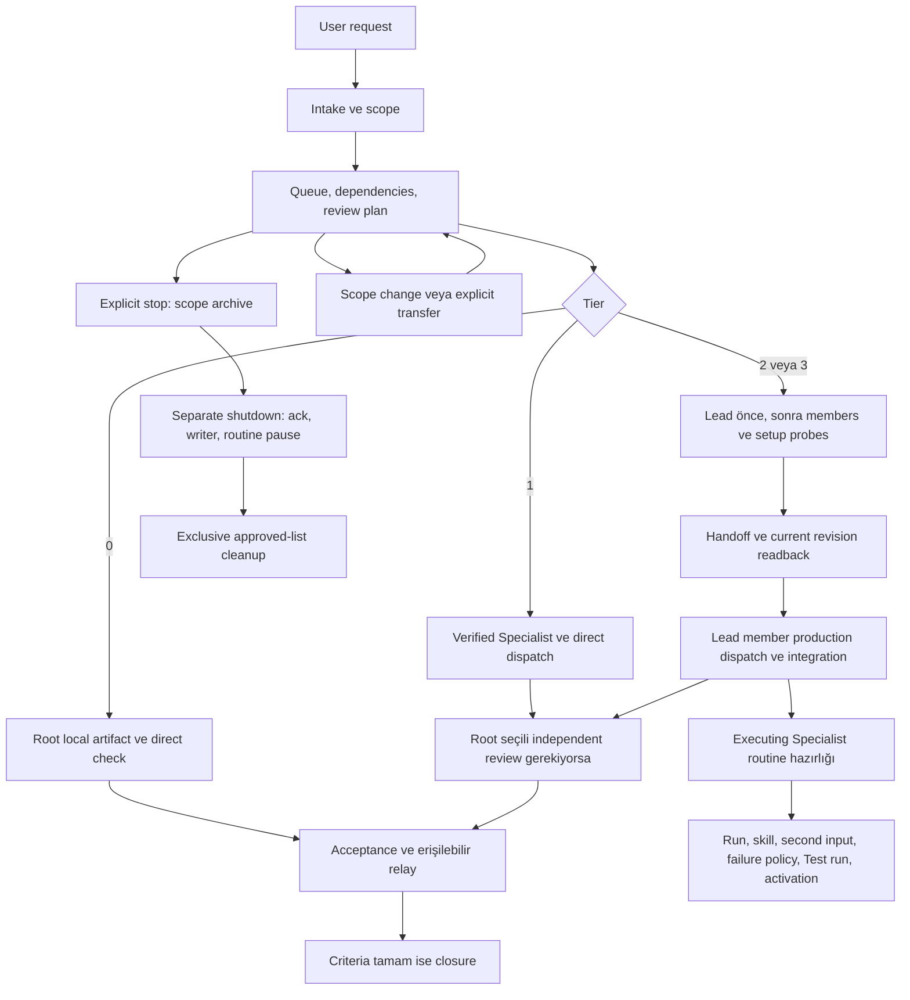

# Root Agent — derin analiz, düzeltmeler ve template paylaşım hazırlığı

**Tarih:** 18 Ekim 2026 (Europe/Istanbul). **Başlangıç:** `f2558ea`, VERSION 0.3.1. **Sonuç sürümü:** 0.3.2. Bu rapor kaynak metinlerini ve yerel araçları değerlendirir; çalışan bir uygulama veya canlı Bot denetimi değildir.

## 1. Yönetici özeti

Kanıtlanan kaynak çelişkileri ve eksik workflow sözleşmeleri düzeltildi. En önemli değişiklik, stop sırasında administrative closure ile gerçek execution/routine shutdown takibini ayırmaktır. Ayrıca tier 0 için uygulanamaz send şartı, onboarding’de yeniden izin sorusu, Lead/member bootstrap döngüsü, transfer sonrası recipient routing, grup içi Reviewer koordinasyonu ve coordinating Lead routine sahipliği giderildi.

On sekiz Root skill’i, iki optional Lead skill’i, description kopyası, iki kanonik template ve embed’leri, kurulum/upgrade belgeleri, generator/validator, requirement tablosu ve bütün C01–C62 tanımları okundu. C63–C82 eklendi. Yeni skill veya sabit Bot bütçesi eklenmedi. Root execution yalnızca tier 0’da; Lead kendi production prompt’larını yazar; Root roster, bağımsız review ve bütün request hesabını tutar; routine executing Specialist’e aittir.

**Yerel sonuç:** başlangıç `PASS 152, FAIL 0`; son kaynak `PASS 165, FAIL 0`; **13 araç regression testi geçti**. Snapshot generator ile üretildi. Koruma etiketli **11 overlay paragrafı**, dağıtım kopyası dahil başlangıçla kelimesi kelimesine aynı kaldı; çelişen genel ifadeler için açık öncelikli istisnalar eklendi. Detaylı gerçek çıktılar [başlangıç kaydı](validation-baseline.txt), [son kayıt](validation-final.txt) ve [JSON](verification-results.json) içindedir.

**Canlı sınır:** Bot oluşturma, gerçek mesaj, routine Test run/activation, connection, template oluşturma/yayımlama yapılmadı. Save/readback, template details, mevcut share link’in paket sürümü ve alıcı kopyası **incelenmedi/doğrulanmadı**. C01–C82 **NOT RUN**. “Düzeltildi” aşağıda kaynak düzeltmesi anlamına gelir; canlı bug giderildi iddiası değildir.

## 2. Resmi template kuralları ve uyumluluk matrisi

Araştırma metin düzenlemesinden önce yapıldı. Aşağıda “zorunluluk” paylaşım koşulunun yükümlülüğünü, “resmi açıklama/tavsiye” dokümante ürün davranışını veya önerisini, “proje tercihi” bu framework’ün daha dar modelini ifade eder. **Uygulamada gözlenen Grok Bot davranışı yoktur.** Sayfalarda görünen güncelleme/yürürlük tarihi ile kontrol tarihi ayrı tutuldu.

| Kural ve niteliği | Yüzey | Doğrudan resmi kaynak / bölüm | Tarih | Projeye etkisi | Doğrulama | Belirsizlik |
| --- | --- | --- | --- | --- | --- | --- |
| Zorunluluk: sensitive configuration incelemesi, confidentiality ve paylaşım hakkı | Tam paylaşılan yapılandırma | [Koşullar — Creating and sharing](https://x.ai/legal/bot-sharing-terms#creating-and-sharing-a-bot) | Yürürlük 22 Ağustos; kontrol 18 Ekim 2026 | Checklist, hak/lisans ve elle hygiene incelemesi | Belge + yerel kaynak taraması; gerçek paket incelenmedi | Otomatik filtre tamlık garantisi değil |
| Resmi açıklama: Public link / Team-only; recipient kendi copy’sini ekler | Audience, identity, description, skills, routines | [Bots — Share a Bot](https://docs.x.ai/grok-bot/bots#share-a-bot) | Güncelleme 12 Ekim; kontrol 18 Ekim 2026 | Audience açık seçilir; tek Root copy; kaynak güncellemesi paylaşım güncellemesi değildir | Belge; UI/preview yapılmadı | Hesap default’u seçilmiş audience kanıtı değildir |
| Resmi açıklama: instructions/memories/skills/plugins recipe’si; custom code/script/MCP tam kopyalanmaz | Template payload ve recipient setup | [Template rehberi — basics / Adding templates](https://x.ai/bot/guides/templates-for-grok-bot) | Yayın 8 Eylül; kontrol 18 Ekim 2026 | Runtime repo/script bağımlılığı yok; full library readback ve kendi bağlantısı | Belge + self-contained source review | Hangi skill/memory/plugin’in seçildiği actual details gerektirir |
| Resmi tavsiye: gerçek task → skill → automation; Test run gerçek etki yapabilir; dört failure ilkesi | Skill/routine | [Skills and routines — Test before enabling / Design for trust](https://docs.x.ai/grok-bot/skills-routines-and-automations) | Güncelleme 12 Ekim; kontrol 18 Ekim 2026 | Mevcut sıralama korundu; pause/test/activation owner contract’ına taşındı | Belge + kaynak; canlı Test run yok | Safe disabled-create imkânı uygulamada doğrulanmalı |
| Resmi açıklama: o sayfada 50 routine/Bot, 20 run history ve en az beş dakika schedule aralığı belirtiliyor | Routine kapasite ve history | [Routines — Manage routines](https://docs.x.ai/grok-bot/skills-routines-and-automations#manage-routines) | Güncelleme 12 Ekim; kontrol 18 Ekim 2026 | Runtime kontrol, owner folder’da run/effect kanıtı; sabit framework Bot bütçesi eklenmedi | Belge; hesap limiti gözlenmedi | Plan/rollout değişebilir; metindeki sayı live quota sayılmaz |
| Resmi açıklama/tavsiye: somut approval sınırı, güvenli secret giriş ve shared-computer sınırı | Eylem, connection, çalışma verisi | [Approvals — boundary / shared-computer / sharing](https://docs.x.ai/grok-bot/approvals-security-and-privacy) | Güncelleme 12 Ekim; kontrol 18 Ekim 2026 | Başka Bot approval’ı yanıtlanmaz; redacted evidence; namespace güvenlik izolasyonu değil | Belge + kaynak; approval UI denenmedi | Prompt kuralları platform kontrolü yerine geçmez |
| Resmi açıklama: published Team Bot bir shared Bot; discovery description 140 karakter | Ayrı Team Bot yüzeyi | [Team Bots — comparison / Publish](https://docs.x.ai/grok-bot/team-bots) | Güncelleme 15 Ekim; kontrol 18 Ekim 2026 | Team-only template ile karıştırılmadı; 140 başka field’a taşınmadı | Belge; Team Bot kurulmadı | Bu sayı personal profile/skill/template toplam limiti değildir |
| Resmi açıklama: async Bot handoff ve admin tarafından kapatılabilen Bot messaging; group handoff text-only | Messaging, group | [Message and collaborate — handoffs / group](https://docs.x.ai/grok-bot/chat-and-collaboration) | Güncelleme 13 Ekim; kontrol 18 Ekim 2026 | SendToAgent taşınabilir operation etiketi; supported capability doğrulanır | Belge; actual tool adı/izni doğrulanmadı | Messaging kapalıysa dispatch blocked; isim uydurulmaz |
| Proje tercihi: tek Root, tier 0 istisnası, Lead kendi production dispatch’i, independent review Root’ta, routine Specialist’te | Description, skills, templates | [Contributor guide](../AGENTS.md) | Mevcut proje modeli | Bütün düzeltmeler bu sınırda | Kaynak karşılaştırması | Resmi platform default’u olarak sunulmaz |

**Kaynak farkı:** 8 Eylül rehberi anonimleştirme/kişisel unsurları dışlama niyetini ve farklı Share/Publish etiketlerini anlatıyor; 12 Ekim dokümanı ve 22 Ağustos yürürlük tarihli paylaşım koşulları tam shared configuration için yayıncının inceleme sorumluluğunu açık tutuyor. Bunları “otomatik filtre güvenlidir” sonucuna birleştirmedim. UI etiketleri sürüme göre doğrulanacak; actual details/readback eksikliği açık kaldı.

### 6000 karakter araştırmasının sonucu

**Resmi kaynakta doğrulanamadı.** Beş zorunlu resmi sayfa açıldı; ayrıca Team Bots, settings ve messaging sayfaları, `site:docs.x.ai/grok-bot "6000"`, `site:x.ai "bot" "6000 characters"`, `"6,000"` ve alan/character-limit aramaları kontrol edildi. Sonuçlarda görünen Grok Build timeout/token/read limitleri başka ürün/yüzeylere aitti ve burada kural kabul edilmedi. Bu tarama sınırın bulunmadığını ispatlamaz.

| Soru | Sonuç | Gerekli uygulama kanıtı |
| --- | --- | --- |
| Personal profile description alanında 6000 var mı? | Bilinmiyor; resmi açık doğrulama bulunamadı | Alan adı, app/version, tam save/readback |
| Template tanıtım metni ile profile instruction aynı alan mı? | Aynı oldukları doğrulanmadı; ayrı kontrol edilecek | Her iki alanın UI kimliği/actual contents |
| Skill başına mı, belirli field’a mı, toplam template’e mi? | Hiçbirine 6000 atanmadı | İlgili field veya export hata/başarı kanıtı |
| Karakter / UTF-16 / UTF-8 byte / token mı? | Resmi birim doğrulanmadı | Host’un tanımı; yerel ölçümler aşağıda ayrı |
| Boşluk ve newline sayılır mı? | Host kuralı bilinmiyor | Kontrollü safe field denemesi |
| Save, template oluşturma veya yayın aşaması mı? | Bilinmiyor | Her aşamaya ait gerçek sonuç |
| Plan, sürüm veya platform farkı var mı? | Bilinmiyor | Aynı field için hesap/app bağlamı |

6000 validator’a konmadı, compatibility hedefi de seçilmedi; doğrulanmış limit olmadan davranış kaybettiren kısaltma yapılmadı. Source ölçümü save veya paketleme başarısı değildir.

## 3. Sistem ve sahiplik haritası

| Rol | Sahiplik | Kalıcı kayıt/yazıcı | Sınır |
| --- | --- | --- | --- |
| Root | Intake, scope, queue, tier/roster, bütün review seçim/dispatch’i, request acceptance ve relay | Kendi instance koordinasyon dosyalarının tek yazıcısı | Domain execution yalnızca tier 0; routine sahibi değil; başka Bot approval’ını yanıtlamaz |
| Lead | Domain team production prompt’ları, günlük koordinasyon, dependency ve integration sonucu | Kendi Lead/integration dosyaları; member artifact’ı değil | Root roster/review yetkisini alamaz; routine execution Specialist’te; scope artışı öneri |
| Specialist | Tek production outcome, kendi assigned artifacts, authorized routine execution | Kendi folder/artifact/run-effect kayıtları | Güncel Lead/Root stage sözleşmesi; ayrı approval ve revision kapısı |
| Reviewer | Exact artifact + criteria revision üzerinde bağımsız kontrol | Kendi review raporu; producer dosyası değil | Producer/repairer/integrator olamaz; bu stage’in coordinator ve alıcısı Root |



Task disposition, execution, delivery, domain management ve review ayrı alanlardır. Parent closure her accepted/deferred requirement ve gereken review gate ile uzlaştırılır. Shared dependency iptali başka aktif task’a taşmaz. Capacity split bir domain’i peer Lead-managed team’lere böler; team ID, nonoverlapping scope/writer ve integration owner açıktır; nested team yoktur.

### Bütün skill’lerin workflow haritası

Tabloda kayıtlar Root’un verified instance kayıtlarıdır; Lead ve Specialist kendi execution artifact’larının yazıcısıdır. “İç” yetki yalnızca task içi koordinasyon/okuma/own record içindir; dış send, publication, deletion, purchase, connection ve production/account değişikliği için somut acting-Bot approval sınırı her satırda yürürlüktedir.

| Skill | Trigger / güncel girdiler | Karar/çıktı ve sahip olduğu koordinasyon kaydı | Sonraki handoff | Hata/eksik erişim | Approval / senaryo |
| --- | --- | --- | --- | --- | --- |
| [getting-started](../root-agent-template/skills/getting-started.md) | İlk temas; own user messages/config | Hedef, gönüllü preferences, own profile/setup | intake-clarify | Goal açıksa bekleme; storage yoksa konuşma-only | İç; yeni connection ayrı / C01,C02,C36,C60,C74 |
| [intake-clarify](../root-agent-template/skills/intake-clarify.md) | Yeni/değişen request; brief/queue/decisions | Tam outcome, scope, revision ve material questions | scope-guard → work-control → routing | Eksik esas target/authority dependent işi tutar | İç; credential secure entry / C01,C02,C28,C36,C42 |
| [scope-guard](../root-agent-template/skills/scope-guard.md) | Büyük request/expansion/checkpoint; tam requirements | P0/P1/deferred, effort, revisit; decisions | work-control ve assignment contract | User conflict tek karar; scope sessiz azalmaz | Yeni effect/cost/access ayrı / C30,C49,C50 |
| [work-control](../root-agent-template/skills/work-control.md) | Ready/stall/change/report; queue/receipt/dependency | Stage owner/readiness, ayrı states, queue/decisions/shutdown | route veya Lead sender; blocker; reporting | Unknown/blocked; log repair receipt’ten; stop ayrı | İç; monitoring somut schedule / C28–C30,C51,C52,C56,C61,C63–C72,C78 |
| [roster-management](../root-agent-template/skills/roster-management.md) | Eksik owner/capacity/role; actual profiles | Verified identities, role/capability/performance, domain reservations | setup dispatch veya Lead handoff | Ambiguous create önce inspect; quota belirsizliği açık | Standing scoped creation; group/connection ayrı / C04–C06,C09,C10,C31,C37,C62,C74,C82 |
| [access-probe](../root-agent-template/skills/access-probe.md) | Unverified/lapsed required operation; acting Bot/tools | Operation readiness/evidence/refresh; capability card girdisi | roster/work-control/blocker | No consequential probe; unknown inventory unverified | Safe read/own probe; connection ayrı / C15,C21,C31,C48,C58,C77,C79 |
| [team-prompting](../root-agent-template/skills/team-prompting.md) | Role/stage/review/revision; accepted brief | Validated role/private prompt; prompts index | Tek sender’a validated text | Eksik authority → yalnız bağımsız draft; send iddiası yok | Existing profile change scoped / C37,C38,C42,C66–C68 |
| [route-and-dispatch](../root-agent-template/skills/route-and-dispatch.md) | Root-managed ready stage; roster/domain/receipt | Tier/current recipient, actual send evidence; shared dispatch log | owner; quality-review; relay | Ambiguous inspect; successful send log failure resend değil | İç send; external action yetkisi ayrı / C03–C12,C38,C43,C44,C52,C63–C68,C75 |
| [lead-handoff](../root-agent-template/skills/lead-handoff.md) | Lead-managed package/change; verified roster/budget | Current delivery key/readback; domains/dispatch/decisions | Lead member execution; Root review | Pending current readback; transfer açık; no member workaround | İç handoff; acting Bot approval / C10,C43,C45,C46,C55,C66–C69,C74 |
| [quality-review](../root-agent-template/skills/quality-review.md) | Important gate/returned/repaired output; exact criteria/artifact | Root Reviewer selection, checklist/gate/repair count | Root reviewer dispatch; corrections owner/Lead | Required unverified→blocked; bounded cycles | Review external action izni vermez / C32,C33,C41,C47,C63,C75 |
| [blocker-escalation](../root-agent-template/skills/blocker-escalation.md) | Evidence stall/ambiguous/reached limit; actual source | Primary cause, responsible party, safe resume/transfer checklist | work-control, ilgili tek sender | Unknown cause; prior effects/writers çözülmeden retry yok | Mevcut scope; başka Bot approval yok / C08,C30,C45,C51,C52,C70,C78 |
| [standing-workspace](../root-agent-template/skills/standing-workspace.md) | Setup/reopen/write/forget; actual own identity | Instance binding ve record contracts; own files | Diğer skill’ler aynı records’ı tüketir | Collision/persistence/concurrency sınırı açık | Own scoped records; forgetting explicit / C22–C25,C40,C67,C78–C80 |
| [bind-routine-via-owner](../root-agent-template/skills/bind-routine-via-owner.md) | Recurring/authorized monitor; owner/source/timing | Complete owner routine contract + queue reference | Lead veya direct Specialist; evidence Root’a | Missing schedule/test/safe activation blocked; report retry ayrı | Somut routine scope; dış etkiler ayrı / C16–C21,C27,C39,C69,C76 |
| [learning-loop](../root-agent-template/skills/learning-loop.md) | Correction/lesson/forget; current evidence/decisions | Responsible workflow correction; learning/decisions | Owner/Lead sender; routine retest/review | Suspected cause kesin policy değil; private data taşınmaz | Durable scope expansion ayrıca / C24,C26,C34,C40,C42 |
| [portfolio-status](../root-agent-template/skills/portfolio-status.md) | Çok task/domain ve status; reopened current records | Attributed active view; owned durable queue yok | work-control reconciliation | Unknown/stalled/pending; closed hariç; safety ayrı | Yalnız current conversation / C35,C53,C61,C65,C81 |
| [result-relay](../root-agent-template/skills/result-relay.md) | Owner/reviewer/routine artifact; actual accessible path | Attributed full/partial carry; received artifact reference | work-control/user-report | Unreachable route açık; attachment fallback; late stop scope kapalı | Relay publishing izni değil / C11,C12,C27,C54,C69,C81 |
| [user-report](../root-agent-template/skills/user-report.md) | Meaningful change/decision/closure; all criteria/review | Task status, digest, measured effort; closure evidence | work-control veya cross-task portfolio | Missing review/criteria closure tutar; tier0 send istisnası | Kendi conversation; other-Bot approval relay yok / C11–C13,C33–C35,C41,C59,C62–C65,C81 |
| [deleted-work-cleanup](../root-agent-template/skills/deleted-work-cleanup.md) | Confirmed deleted owner/cancel; queue/shutdown/actual files | Archive, exclusive approved list, actual removed/skipped state | Shutdown safety veya approved cleanup | Unreachable/group deletion iptal değil; changed list bekler | Deletion Root chat somut approval / C57,C61,C69–C73 |

Optional `lead-dispatch`: current package → member prompt/receipt/checkpoint → integration; duplicate/revision/stop safeties kendi description’ında da var. Optional `lead-integrate`: actual member artifacts/revisions → criterion-by-criterion domain artifact; content repair producing member’a döner, Lead yalnız own integration artifact’ını yazar. İkisi de Root review gate’ini veya dış eylem authority’sini alamaz; kurulu değillerse canonical Lead description zorunlu akışı taşır.

## 4. Önceliklendirilmiş bulgular

Bulgular aynı kök nedenin dosya başına tekrarları olarak sayılmadı. Bütün kaynak bulguları mevcut metin ve eski revision karşılaştırmasından gelir. Riskin fiilen gerçekleştiği iddia edilmez.

| ID | Bulgu | Tür | Önem | Kanıt | Akış | Durum |
| --- | --- | --- | --- | --- | --- | --- |
| F02 | Tier seçimi ve genel dispatch kuralları yerel/henüz hazır olmayan işleri kapsamıyordu | Mevcut bug | yüksek | Kaynakta doğrulandı; yerel/senaryo sınırı ayrıntıda | C07, C43–C44, C63–C65 | düzeltildi (kaynak) |
| F03 | Lead/member bootstrap sırası ve access kapısı döngü oluşturuyordu | Mevcut bug | yüksek | Kaynakta doğrulandı; yerel/senaryo sınırı ayrıntıda | C23, C37, C48, C74, C77, C80 | düzeltildi (kaynak) |
| F04 | Recipient resolution güncel management transfer’ını ve grup içi Reviewer’ı tüketemiyordu | Mevcut bug | yüksek | Kaynakta doğrulandı; yerel/senaryo sınırı ayrıntıda | C10, C32, C45–C47, C52, C75 | düzeltildi (kaynak) |
| F05 | Transport retry ve package revision için alıcı tarafı idempotence eksikti | Mevcut GAP | yüksek | Kaynakta doğrulandı; yerel/senaryo sınırı ayrıntıda | C08, C38, C45, C55, C66–C68 | düzeltildi (kaynak) |
| F06 | Administrative closure gerçek stop takibini iptal edebiliyordu | Mevcut bug | yüksek | Kaynakta doğrulandı; yerel/senaryo sınırı ayrıntıda | C28, C52, C57, C61, C69–C72 | düzeltildi (kaynak) |
| F07 | Cleanup onayından sonra dosya kapsamı yeniden doğrulanmıyordu | Potansiyel bug | yüksek | Kaynakta doğrulandı; yerel/senaryo sınırı ayrıntıda | C57, C69, C73 | düzeltildi (kaynak) |
| F08 | Verbatim evidence/history yükümlülüğü privacy ve forgetting ile çatışıyordu | Mevcut bug | yüksek | Kaynakta doğrulandı; yerel/senaryo sınırı ayrıntıda | C14–C15, C24, C40, C55, C79 | düzeltildi (kaynak) |
| F09 | Koordinasyon yapan Lead routine execution sahibi olabiliyordu | Mevcut bug | yüksek | Kaynakta doğrulandı; yerel/senaryo sınırı ayrıntıda | C16–C21, C27, C39, C69, C74, C76 | düzeltildi (kaynak) |
| F01 | Onboarding mevcut creation yetkisini yeniden şart koşuyordu | Mevcut bug | orta | Kaynakta doğrulandı; yerel/senaryo sınırı ayrıntıda | C01–C02, C36, C60, C74 | düzeltildi (kaynak) |
| F10 | One-writer kuralı aynı Root’un eşzamanlı turn’lerinde revision güvenliği tanımlamıyordu | Potansiyel GAP | orta | Kaynakta doğrulandı; yerel/senaryo sınırı ayrıntıda | C23, C29, C67, C78 | kısmen düzeltildi (kaynak sözleşmesi tamam; platform güvencesi bilinmiyor) |
| F11 | Portfolio state listesi unknown’u dışlıyor, attachment zorunluluğu fallback vermiyordu | Mevcut GAP | orta | Kaynakta doğrulandı; yerel/senaryo sınırı ayrıntıda | C11–C12, C35, C53–C54, C81 | düzeltildi (kaynak) |
| F12 | Structural check ilan ettiği section/byte/hygiene özelliklerini tam ölçmüyordu | Mevcut bug | orta | Kaynakta doğrulandı; yerel/senaryo sınırı ayrıntıda | C79–C80 + 13 yerel araç testi (canlı case yürütmez) | düzeltildi (kaynak) |
| F13 | Setup generator çalışma dizinine bağımlı ve başarısız yazıma karşı korumasızdı | Mevcut bug | orta | Kaynakta doğrulandı; yerel/senaryo sınırı ayrıntıda | Yerel arbitrary-cwd, -O, missing-source ve failed-replace regression testleri | düzeltildi (kaynak) |
| F15 | Template aktarımı ve paylaşım kabulü için somut içerik/dependency kontrolü eksikti | Mevcut GAP | orta | Kaynakta doğrulandı; yerel/senaryo sınırı ayrıntıda | C25, C37, C74, C80–C81 | düzeltildi (kaynak) |
| F14 | Measured metrics için population ve olay sayım kuralları eksikti | Mevcut GAP | düşük | Kaynakta doğrulandı; yerel/senaryo sınırı ayrıntıda | C62, C82 | düzeltildi (kaynak) |

## 5. Ayrıntılı bulgular ve uygulanan düzeltmeler

Eski satır referansları `f2558ea` commit’ine, tıklanabilir dosya/satır referansları güncel kaynağa aittir; satır numaraları dosyalardan yeniden hesaplandı. Eski alıntı ve yeni alıntı gerçekten ilgili source içinde bulunuyor. Tam değişen satırlar [hazır PR açıklamasında](PR-DESCRIPTION.md). Bütün Bot davranış senaryolarının canlı durumu NOT RUN’dır.

### F01 — Onboarding mevcut creation yetkisini yeniden şart koşuyordu

- **Tür:** Mevcut bug. **Önem:** orta.
- **Kanıt durumu:** Kaynak metinde doğrulandı; hata yolu senaryo analiziyle destekleniyor. Tool bulgularında ayrıca gerçek yerel regression kanıtı var; canlı Grok Bot kanıtı yok.
- **Etkilenen kaynak ve doğrulanmış satırlar:** [root-agent-template/skills/getting-started.md:L19](../root-agent-template/skills/getting-started.md#L19); [root-agent-template/description.md:L29](../root-agent-template/description.md#L29). Başlangıç: `f2558ea:root-agent-template/skills/getting-started.md:L33`; `f2558ea:root-agent-template/description.md:L7`.
- **İlgili kural / çelişki:** Description gerekli Specialist oluşturmayı zaten yetkilendirirken getting-started son bölümü bu yetkiyi beşinci sorunun cevabına bağlıyordu. Beş soruluk sıra ile intake’ın yalnızca maddi eksikleri tek mesajda toplama kuralı da çatışıyordu.
- **Tetikleyici başlangıç koşulu:** Yeni alıcı açık bir task verir; adı veya onboarding izin sorusu yanıtlanmamıştır.
- **Hataya giden olay sırası:** Açık hedef → zorunlu görünen soru sırası → zaten verilmiş creation yetkisinin yeniden beklenmesi.
- **Beklenen davranış:** Açık task ilerler; yalnızca yetki gerçekten yoksa veya mevcut kullanıcı kısıtlamışsa eksik karar istenir.
- **Önceki kaynakların yönlendirdiği davranış:** Aynı creation eylemi description’a göre yetkili, skill’e göre soru 5 yanıtına kadar yetkisizdi.
- **Kullanıcı/sistem etkisi:** İlk sonuç gecikir, aynı izin tekrar sorulur veya hangi kurala uyulacağı belirsizleşir.
- **Kök neden:** Onboarding’in ayrı bir yetki kaynağı gibi yazılması.
- **Karşı kanıt ve mevcut korumalar:** getting-started zaten “if a task arrives early, start on it” diyordu; intake adı şart koşmuyordu. Bu korumalar son approval cümlesinin ters koşulunu kaldırmıyordu.
- **Uygulanan düzeltme:** Goal yoksa tek hedef sorusu; goal varsa hemen intake. Mevcut sahibin güncel talimatları ve kurulu description doğrulanır; yayıncının özel onayları taşınmaz. Eksik storage konuşma içinde açık tutulur.
- **Davranış değişikliği — eski İngilizce alıntı → yeni İngilizce alıntı:**

````text
standing creation authority applies only if the owner grants it in question 5.
→
The installed description's standing task authority covers necessary Bot creation and scoped internal handoffs unless the current owner restricts it.
````

- **Etkilenen kopyalar ve senaryolar:** getting-started, kanonik/paste description, INSTALL ve generator kurulum başlığı. C01–C02, C36, C60, C74.
- **Regression riski:** Mevcut sahibin creation kısıtlaması atlanmamalı; bu istisna açık tutuldu.
- **Doğrulama yöntemi, sonuç ve geçme koşulu:** Kaynak karşılaştırması ve structural guard geçti. Geçme koşulu: açık task için opsiyonel onboarding beklememek, yetki kısıtlamasını korumak; canlı gözlem NOT RUN.
- **Durum:** düzeltildi (kaynak).
- **Açık belirsizlik:** Grok Bot davranışı canlı denenmedi; kaynak kuralının bulunması uygulama güvenilirliğini kanıtlamaz.

### F02 — Tier seçimi ve genel dispatch kuralları yerel/henüz hazır olmayan işleri kapsamıyordu

- **Tür:** Mevcut bug. **Önem:** yüksek.
- **Kanıt durumu:** Kaynak metinde doğrulandı; hata yolu senaryo analiziyle destekleniyor. Tool bulgularında ayrıca gerçek yerel regression kanıtı var; canlı Grok Bot kanıtı yok.
- **Etkilenen kaynak ve doğrulanmış satırlar:** [root-agent-template/skills/route-and-dispatch.md:L15](../root-agent-template/skills/route-and-dispatch.md#L15); [root-agent-template/skills/work-control.md:L35](../root-agent-template/skills/work-control.md#L35); [root-agent-template/skills/user-report.md:L24](../root-agent-template/skills/user-report.md#L24). Başlangıç: `f2558ea:root-agent-template/skills/work-control.md:L29`; `f2558ea:root-agent-template/skills/user-report.md:L22`; `f2558ea:root-agent-template/description.md:L9`.
- **İlgili kural / çelişki:** Tier 0 kendi işi olduğu halde her task için SendToAgent satırı aranıyordu. Küçük fakat bağımsız review isteyen iş aynı anda tier 0 ve tier 2 koşuluna uyabiliyordu.
- **Tetikleyici başlangıç koşulu:** Aynı turda küçük yerel iş, ready owner işi, blocked ve deferred işler açılır; bir küçük işte bağımsız review istenir.
- **Hataya giden olay sırası:** Task açılır → bütün kayıtlar için send aranır → yerel/blocked iş not-dispatched sayılır veya gereksiz gönderilir; tier koşulları farklı sonuç verebilir.
- **Beklenen davranış:** Önce domain/parallel/review ihtiyacı değerlendirilir; gerçek tier 0 yerel kanıtla kapanır. Yalnızca hazır ve mesaj gerektiren stage gönderilir.
- **Önceki kaynakların yönlendirdiği davranış:** Gönderilmesi gerekmeyen iş için uygulanamaz mesaj kanıtı şartı ve önceliği tanımsız tier örtüşmesi vardı.
- **Kullanıcı/sistem etkisi:** Yanlış durum raporu, gereksiz self-send, erken dispatch veya Root’un review gereken işi üretmesi riski.
- **Kök neden:** İstisnasız bütün task/state ifadeleri ile tier koşullarının sırasız yazılması.
- **Karşı kanıt ve mevcut korumalar:** Route tier 0 için “No Bot is created” ve kısa istisnaları birleştirmeme koruması taşıyordu. Bu, overlay’in her task için send satırı şartını çözmüyordu.
- **Uygulanan düzeltme:** Tier 3 → tier 2 → uygun tier 0 → tier 1 sırası; yerel brief/direct check ve delivery:not-required; unready stage istisnası; state değişikliklerinde uygun kanıt türü. Korunmuş overlay’e açık öncelikli istisnalar eklendi.
- **Davranış değişikliği — eski İngilizce alıntı → yeni İngilizce alıntı:**

````text
Before ending the turn, check that every task opened in the turn has its own SendToAgent line in dispatch-log.md; a missing line means the task is `not-dispatched` and is reported as such.
→
Tier 0 is local execution with direct-check evidence and `delivery: not-required`; it needs no Bot prompt, self-send or send log.
````

- **Etkilenen kopyalar ve senaryolar:** Description ve kopyası; work-control, route-and-dispatch, team-prompting, roster-management, user-report; README. C07, C43–C44, C63–C65.
- **Regression riski:** Tier 0 review gate’ini veya büyüklük sınırını aşmamalı; bütün kabul edilmiş scope üzerinden karar korunur.
- **Doğrulama yöntemi, sonuç ve geçme koşulu:** Kaynak walkthrough ve static guard geçti. Geçme koşulu: tier 0 self-send yok; blocked/deferred üretim açılmaz; review gereken küçük iş tier 2. Canlı NOT RUN.
- **Durum:** düzeltildi (kaynak).
- **Açık belirsizlik:** Grok Bot davranışı canlı denenmedi; kaynak kuralının bulunması uygulama güvenilirliğini kanıtlamaz.

### F03 — Lead/member bootstrap sırası ve access kapısı döngü oluşturuyordu

- **Tür:** Mevcut bug. **Önem:** yüksek.
- **Kanıt durumu:** Kaynak metinde doğrulandı; hata yolu senaryo analiziyle destekleniyor. Tool bulgularında ayrıca gerçek yerel regression kanıtı var; canlı Grok Bot kanıtı yok.
- **Etkilenen kaynak ve doğrulanmış satırlar:** [root-agent-template/templates/lead-description.md:L1](../root-agent-template/templates/lead-description.md#L1); [root-agent-template/skills/roster-management.md:L17](../root-agent-template/skills/roster-management.md#L17); [root-agent-template/skills/access-probe.md:L14](../root-agent-template/skills/access-probe.md#L14). Başlangıç: `f2558ea:root-agent-template/templates/lead-description.md:L1`; `f2558ea:root-agent-template/skills/roster-management.md:L64`; `f2558ea:root-agent-template/description.md:L9`.
- **İlgili kural / çelişki:** Lead uygulanmadan önce gerçek member referansları isteniyor; Specialist description ise gerçek assigning coordinator istiyordu. Üst description create öncesi yeni Bot’un kendi probe’unu şart koşarken setup istisnası başka skill’deydi.
- **Tetikleyici başlangıç koşulu:** Yalnızca Root bulunan hesapta yeni Lead ve üyeler gerekir; hiçbirinin kimliği/folder’ı yoktur.
- **Hataya giden olay sırası:** Lead açıklaması için üyeler → üyeler için gerçek Lead → create öncesi henüz var olmayan Bot’un erişim kanıtı.
- **Beklenen davranış:** Lead’in kalıcı rolü önce doğrulanır, sonra üyeler gerçek Lead ile oluşturulur; ayrı setup/probe production öncesi çalışır.
- **Önceki kaynakların yönlendirdiği davranış:** Bazı kurallar uygulanabilir bootstrap’a izin verirken daha genel description ve placeholder talebi bunu engelleyebiliyordu.
- **Kullanıcı/sistem etkisi:** Kurulumun bloklanması, uydurma Bot ID/roster veya kalıcı profile değişken task üyelerinin yazılması.
- **Kök neden:** Kalıcı rol ile task roster’ının karışması ve setup istisnasının bütün yüzeylere yayılmaması.
- **Karşı kanıt ve mevcut korumalar:** Roster step 7 ve access-probe step 9 setup istisnasını zaten içeriyordu; sorun bunun yokluğu değil, genel kapı ve Lead description ile çelişmesiydi.
- **Uygulanan düzeltme:** Lead roster’ı handoff’a taşındı; Lead-first sırası ve production-dışı setup istisnası description/skills/templates boyunca eşitlendi. Gerçek library/plugin durumu gözlenir; otomatik inheritance veya yokluk varsayılmaz. Bilinmeyen connector inventory erişim kanıtı sayılmaz.
- **Davranış değişikliği — eski İngilizce alıntı → yeni İngilizce alıntı:**

````text
Your members are [MEMBER BOT REFERENCES AND THEIR OWNED DELIVERABLES]; your boundaries are [EXCLUSIONS AND HANDOFFS].
→
Take current member references and assignments from Root Agent's verified handoff roster, keeping task-specific roster changes out of this permanent description.
````

- **Etkilenen kopyalar ve senaryolar:** Lead template ve roster embed’i, description kopyası, roster-management, route-and-dispatch, access-probe, opsiyonel lead-dispatch ve kurulum belgeleri. C23, C37, C48, C74, C77, C80.
- **Regression riski:** Setup istisnasının production izni sayılması önlendi; sadece kendi folder/probe kapsamı verildi.
- **Doğrulama yöntemi, sonuç ve geçme koşulu:** Template/embed ve snapshot eşitliği geçti; source walkthrough uygulanabilir sırayı gösteriyor. Geçme koşulu: uydurma kimlik yok, yeni Bot kendi probe’unu creation sonrasında yapar. Canlı NOT RUN.
- **Durum:** düzeltildi (kaynak).
- **Açık belirsizlik:** Grok Bot davranışı canlı denenmedi; kaynak kuralının bulunması uygulama güvenilirliğini kanıtlamaz.

### F04 — Recipient resolution güncel management transfer’ını ve grup içi Reviewer’ı tüketemiyordu

- **Tür:** Mevcut bug. **Önem:** yüksek.
- **Kanıt durumu:** Kaynak metinde doğrulandı; hata yolu senaryo analiziyle destekleniyor. Tool bulgularında ayrıca gerçek yerel regression kanıtı var; canlı Grok Bot kanıtı yok.
- **Etkilenen kaynak ve doğrulanmış satırlar:** [root-agent-template/skills/route-and-dispatch.md:L37](../root-agent-template/skills/route-and-dispatch.md#L37); [root-agent-template/skills/quality-review.md:L18](../root-agent-template/skills/quality-review.md#L18); [root-agent-template/templates/specialist-description.md:L7](../root-agent-template/templates/specialist-description.md#L7); [root-agent-template/skills/standing-workspace.md:L20](../root-agent-template/skills/standing-workspace.md#L20). Başlangıç: `f2558ea:root-agent-template/skills/route-and-dispatch.md:L36`; `f2558ea:root-agent-template/skills/route-and-dispatch.md:L40`; `f2558ea:root-agent-template/skills/lead-handoff.md:L51`.
- **İlgili kural / çelişki:** Resolver yalnızca Lead profilinin varlığına bakıyordu. Açık transfer sonrası eski verified Lead kaydı durunca yine Lead’e dönüyordu. Review bütün tier’larda Root’a aitken doğrudan-send istisnası sadece grup dışı Reviewer için tanımlıydı.
- **Tetikleyici başlangıç koşulu:** Management açıkça Root’a geri alınır veya Reviewer domain grubuna oturur; aynı domain kapasite nedeniyle peer team’lere bölünür.
- **Hataya giden olay sırası:** Transfer root-managed olarak yazılır → resolver eski verified Lead’i görür → lead-handoff’a geri yönlenir; grup içi review’da da Lead yolu seçilebilir.
- **Beklenen davranış:** Geçerli dispatch owner ve team kimliği belirleyici; tüm bağımsız review stage’leri Root tarafından gönderilir ve Root’a döner.
- **Önceki kaynakların yönlendirdiği davranış:** Profilin gerçek olması, hâlâ management sahibi olmakla eşitleniyordu; kalıcı production coordinator review dönüşünü de sahiplenebiliyordu.
- **Kullanıcı/sistem etkisi:** Routing döngüsü, iki sender veya Lead’in kendi domain review’unu yönetmesi riski.
- **Kök neden:** Recipient kararının stage amacı ve ownership revision yerine yalnızca profil varlığını kullanması.
- **Karşı kanıt ve mevcut korumalar:** Quality-review ve Root description review seçimini açıkça Root’ta tutuyordu; roster grup içi Reviewer seat’ini tanıyordu. Dar resolver istisnası bunları karşılamıyordu.
- **Uygulanan düzeltme:** İki sender’da aynı blok: önce açık transfer/güncel dispatch owner, sonra güncel Lead; bütün Reviewer stage’leri doğrudan Root. Peer team kayıtları ve integration owner ayrı tutulur. Lead kaynaklı prompt hatası varsa düzeltme Lead’e gider; her kusur handoff paketine mal edilmez.
- **Davranış değişikliği — eski İngilizce alıntı → yeni İngilizce alıntı:**

````text
Domain has a verified Lead (actual Bot reference plus profile readback)? -> lead-handoff
→
Explicit transfer made Root the current dispatch owner?                 -> route-and-dispatch
````

- **Etkilenen kopyalar ve senaryolar:** Her iki recipient bloğu ve README kopyası; quality-review, Specialist/Lead template ve embed’leri, domains record contract, team-prompting, learning-loop. C10, C32, C45–C47, C52, C75.
- **Regression riski:** Review istisnası production kickoff’a dönüşmemeli; distinct review stage ve bağımsızlık kontrolü korundu.
- **Doğrulama yöntemi, sonuç ve geçme koşulu:** Raw-byte recipient equality, template/embed equality ve static guard geçti. Geçme koşulu: eski Lead tarihi korunurken yeni dispatch owner izlenir; grup içi review Root’ta kalır. Canlı NOT RUN.
- **Durum:** düzeltildi (kaynak).
- **Açık belirsizlik:** Grok Bot davranışı canlı denenmedi; kaynak kuralının bulunması uygulama güvenilirliğini kanıtlamaz.

### F05 — Transport retry ve package revision için alıcı tarafı idempotence eksikti

- **Tür:** Mevcut GAP. **Önem:** yüksek.
- **Kanıt durumu:** Kaynak metinde doğrulandı; hata yolu senaryo analiziyle destekleniyor. Tool bulgularında ayrıca gerçek yerel regression kanıtı var; canlı Grok Bot kanıtı yok.
- **Etkilenen kaynak ve doğrulanmış satırlar:** [root-agent-template/skills/lead-handoff.md:L63](../root-agent-template/skills/lead-handoff.md#L63); [root-agent-template/templates/lead-description.md:L5](../root-agent-template/templates/lead-description.md#L5); [root-agent-template/skills/standing-workspace.md:L23](../root-agent-template/skills/standing-workspace.md#L23). Başlangıç: `f2558ea:root-agent-template/skills/lead-handoff.md:L57`; `f2558ea:root-agent-template/templates/lead-description.md:L3`.
- **İlgili kural / çelişki:** Handoff bir resend’e izin veriyordu; zorunlu Lead description aynı package tekrar geldiğinde önceki execution’ı yeniden başlatmama sözleşmesi taşımıyordu. Package revision, task revision ve log hata istisnası bütün yüzeylerde açık değildi.
- **Tetikleyici başlangıç koşulu:** İlk send başarılıdır fakat readback gecikir; checkpoint resend’i ile ilk cevap çakışır veya send sonrası log yazımı başarısız olur.
- **Hataya giden olay sırası:** Aynı package tekrar alınır → yeni kickoff sanılabilir; eski revision readback’i aynı task üzerinden yeni scope’u açabilir; eksik log not-dispatched kuralına takılabilir.
- **Beklenen davranış:** Aynı delivery key yeniden production başlatmaz; readback tam güncel task/stage/scope/package ile eşleşir; receipt record repair için kullanılır.
- **Önceki kaynakların yönlendirdiği davranış:** Sender’da konuşmayı kontrol etme vardı, alıcı için zorunlu tekrar işleme sözleşmesi yoktu.
- **Kullanıcı/sistem etkisi:** Duplicate iş/dış etki, eski scope üzerinde production veya hatalı lead-managed iddiası riski.
- **Kök neden:** Transport delivery ile semantic execution ve revision kabulünün ayrılmaması.
- **Karşı kanıt ve mevcut korumalar:** Route ve handoff ambiguous send’i incelemeyi, route başarılı send sonrası logu tamir etmeyi zaten söylüyordu. Bunlar recipient’in tekrar package işleme davranışını ve çelişen mandatory-log overlay’ini tek başına çözmüyordu.
- **Uygulanan düzeltme:** Kalıcı delivery key; aynı key için en fazla bir transport resend; alıcı mevcut readback/status’u döner. Yeni scope/package için yeni eşleşen readback; eski cevap history. Privacy redaction ve konuşma-only receipt istisnası açık.
- **Davranış değişikliği — eski İngilizce alıntı → yeni İngilizce alıntı:**

````text
If no readback arrives by `checkpoint-due`, resend the same package once (logged) or escalate via blocker-escalation.
→
An exact duplicate package returns the prior readback or current status without another execution;
````

- **Etkilenen kopyalar ve senaryolar:** lead-handoff, standing-workspace, work-control istisnaları, team-prompting; her iki template/embed ve opsiyonel lead-dispatch. C08, C38, C45, C55, C66–C68.
- **Regression riski:** Idempotence yalnızca metin sözleşmesi; platform atomik dedup garantisi değildir.
- **Doğrulama yöntemi, sonuç ve geçme koşulu:** Kaynak correlation sözleşmesi ve quote guard geçti. Geçme koşulu: doğru sender/conversation/revision, korunmuş receipt, key başına bounded retry ve alıcıda ikinci execution yok. Canlı NOT RUN.
- **Durum:** düzeltildi (kaynak).
- **Açık belirsizlik:** Grok Bot davranışı canlı denenmedi; kaynak kuralının bulunması uygulama güvenilirliğini kanıtlamaz.

### F06 — Administrative closure gerçek stop takibini iptal edebiliyordu

- **Tür:** Mevcut bug. **Önem:** yüksek.
- **Kanıt durumu:** Kaynak metinde doğrulandı; hata yolu senaryo analiziyle destekleniyor. Tool bulgularında ayrıca gerçek yerel regression kanıtı var; canlı Grok Bot kanıtı yok.
- **Etkilenen kaynak ve doğrulanmış satırlar:** [root-agent-template/skills/work-control.md:L39](../root-agent-template/skills/work-control.md#L39); [root-agent-template/skills/blocker-escalation.md:L45](../root-agent-template/skills/blocker-escalation.md#L45); [root-agent-template/templates/lead-description.md:L21](../root-agent-template/templates/lead-description.md#L21). Başlangıç: `f2558ea:root-agent-template/skills/work-control.md:L27`; `f2558ea:root-agent-template/skills/work-control.md:L30`; `f2558ea:root-agent-template/skills/work-control.md:L21`.
- **İlgili kural / çelişki:** Bir bölüm stop acknowledgement/state beklerken overlay aynı turda follow-up dahil bütün takibi iptal ediyordu. Ulaşılamayan owner step 15’e yönleniyordu; group/team/Bot silinmesi ayrılmıyordu.
- **Tetikleyici başlangıç koşulu:** Stop aktif üretim/routine sırasında gelir; owner erişilemez veya yalnızca grup silinir; sonra geç sonuç döner.
- **Hataya giden olay sırası:** Kayıt arşivlenir → gerekli stop/ack/routine kontrolü takipten düşer → writer/routine devam ederken kapanmış sayılabilir.
- **Beklenen davranış:** Scope hemen kapanır, fakat yalnızca shutdown güvenlik takibi actual stop ve routine/writer kanıtına kadar sürer.
- **Önceki kaynakların yönlendirdiği davranış:** Kayıt kapanışı execution’ın durmasıyla karışıyor, ulaşamama owner deletion yerine geçebiliyordu.
- **Kullanıcı/sistem etkisi:** İstenmeyen üretim/routine devamı; aktif writer üstüne replacement/cleanup; geç sonucun işi yeniden açması riski.
- **Kök neden:** Task disposition, execution ve shutdown yaşam döngülerinin tek “closed” olayına indirgenmesi.
- **Karşı kanıt ve mevcut korumalar:** Route/work-control/blocker “stop message proves neither stop nor undo” diyordu; routine skill de closure’ın routine’ı durdurmadığını söylüyordu. Overlay’in koşulsuz takip iptali bu korumalarla çatışıyordu.
- **Uygulanan düzeltme:** Arşiv ayrı; domains.md’de shutdown ayrı. Stop önce iletilir; yalnızca acknowledgement, prior effects, writer release ve routine pause izlenir. Unreachable unknown/blocked kalır; group deletion tek başına iptal değildir. Shared dependencies ve geç sonuçlar açık kuralla ele alınır.
- **Davranış değişikliği — eski İngilizce alıntı → yeni İngilizce alıntı:**

````text
Otherwise report "doğrulanmadı" or `stalled?`, and if the owner cannot be reached, follow step 15.
→
A temporarily unreachable owner is unknown or blocked, never proof of deletion and never grounds for step 15.
````

- **Etkilenen kopyalar ve senaryolar:** Work-control overlay istisnaları; blocker, cleanup, reporting/relay, domains contract, iki template/embed ve opsiyonel lead-dispatch. C28, C52, C57, C61, C69–C72.
- **Regression riski:** Shutdown takip bahanesiyle production sürdürülmemeli; sadece güvenlik reconciliation’ı izinli.
- **Doğrulama yöntemi, sonuç ve geçme koşulu:** Kaynak walkthrough ve static safeguards geçti. Geçme koşulu: arşiv aynı turda, stop kanıtı ayrı, shared işler korunmuş, late output yeniden açmıyor. Canlı NOT RUN.
- **Durum:** düzeltildi (kaynak).
- **Açık belirsizlik:** Grok Bot davranışı canlı denenmedi; kaynak kuralının bulunması uygulama güvenilirliğini kanıtlamaz.

### F07 — Cleanup onayından sonra dosya kapsamı yeniden doğrulanmıyordu

- **Tür:** Potansiyel bug. **Önem:** yüksek.
- **Kanıt durumu:** Kaynak metinde doğrulandı; hata yolu senaryo analiziyle destekleniyor. Tool bulgularında ayrıca gerçek yerel regression kanıtı var; canlı Grok Bot kanıtı yok.
- **Etkilenen kaynak ve doğrulanmış satırlar:** [root-agent-template/skills/deleted-work-cleanup.md:L19](../root-agent-template/skills/deleted-work-cleanup.md#L19); [root-agent-template/skills/deleted-work-cleanup.md:L18](../root-agent-template/skills/deleted-work-cleanup.md#L18). Başlangıç: `f2558ea:root-agent-template/skills/deleted-work-cleanup.md:L17`; `f2558ea:root-agent-template/skills/deleted-work-cleanup.md:L16`.
- **İlgili kural / çelişki:** Kaydedilmiş dosya listesi ve onay vardı; onay ile silme arasında dosya, ownership veya writer değişirse aynı kapsamı yeniden açma şartı yoktu.
- **Tetikleyici başlangıç koşulu:** Kullanıcı onayını beklerken klasöre yeni dosya eklenir, writer yeniden başlar veya bir path redirect olur.
- **Hataya giden olay sırası:** Eski liste onaylanır → güncel olmayan sahiplikle deletion uygulanır → yeni/shared dosya veya aktif writer etkilenebilir.
- **Beklenen davranış:** Yalnızca durmuş ve exclusive sahipliği doğrulanmış, değişmemiş onaylı path’ler silinir; genişleyen scope yeniden onaylanır.
- **Önceki kaynakların yönlendirdiği davranış:** Eski listenin execution anındaki güncel kapsamı temsil ettiği varsayılabiliyordu.
- **Kullanıcı/sistem etkisi:** İstenmeyen dosya kaybı; başka aktif task’ın artefaktının silinmesi riski.
- **Kök neden:** Liste snapshot’ı ile deletion execution arasındaki zaman farkı ve path çözümlemesinin tanımsızlığı.
- **Karşı kanıt ve mevcut korumalar:** Eski metin shared/aktif takım dosyalarını koruyor ve explicit approval istiyordu. Bu güçlü koruma mevcut, fakat execution öncesi güncellik/redirect kontrolü eksikti.
- **Uygulanan düzeltme:** Resolved exclusive folder sınırı, redirect reddi, dosya identity/modification kanıtı, anında ownership/writer/routine/list readback; yeni dosya içeren folder’a recursive deletion yok; partial/skipped açık rapor.
- **Davranış değişikliği — eski İngilizce alıntı → yeni İngilizce alıntı:**

````text
After approval, delete, verify the paths are gone, and update the record's evidence line to point at the deletion list.
→
Delete only unchanged listed files; never recursively delete a folder that now contains unlisted files.
````

- **Etkilenen kopyalar ve senaryolar:** deleted-work-cleanup; work-control shutdown önkoşulu; README ve C57 güncellemesi. C57, C69, C73.
- **Regression riski:** Değişmiş dosyaları korumak cleanup’ı kısmi bırakabilir; bu durum başarı diye sunulmaz.
- **Doğrulama yöntemi, sonuç ve geçme koşulu:** Kaynak koşulları ve static guard geçti. Dosya silme yapılmadı. Geçme koşulu: güncel onay kapsamı dışına çıkmama; canlı destructive test NOT RUN.
- **Durum:** düzeltildi (kaynak).
- **Açık belirsizlik:** Grok Bot davranışı canlı denenmedi; kaynak kuralının bulunması uygulama güvenilirliğini kanıtlamaz.

### F08 — Verbatim evidence/history yükümlülüğü privacy ve forgetting ile çatışıyordu

- **Tür:** Mevcut bug. **Önem:** yüksek.
- **Kanıt durumu:** Kaynak metinde doğrulandı; hata yolu senaryo analiziyle destekleniyor. Tool bulgularında ayrıca gerçek yerel regression kanıtı var; canlı Grok Bot kanıtı yok.
- **Etkilenen kaynak ve doğrulanmış satırlar:** [root-agent-template/skills/standing-workspace.md:L33](../root-agent-template/skills/standing-workspace.md#L33); [root-agent-template/skills/access-probe.md:L23](../root-agent-template/skills/access-probe.md#L23); [root-agent-template/skills/deleted-work-cleanup.md:L21](../root-agent-template/skills/deleted-work-cleanup.md#L21). Başlangıç: `f2558ea:root-agent-template/skills/access-probe.md:L23`; `f2558ea:root-agent-template/skills/work-control.md:L31`; `f2558ea:root-agent-template/skills/deleted-work-cleanup.md:L19`.
- **İlgili kural / çelişki:** Exact error/tool result ve verbatim readback kaydı istisnasızdı; mevcut privacy/forgetting kuralları bu veri toplama zorunluluğuna açık öncelik vermiyordu.
- **Tetikleyici başlangıç koşulu:** Tool error veya readback içinde credential/kod/gereksiz kişisel bilgi bulunur; daha sonra kullanıcı forgetting ister.
- **Hataya giden olay sırası:** Verbatim log → özel değer kalıcı prompt/log/cleanup history’ye kopyalanır → history retention ile removal çatışır.
- **Beklenen davranış:** Minimize/redact et; kalan kimlik/revision kanıtı kontrol edilebiliyorsa redacted diye işaretle; forgetting eski log ve cleanup history’yi de kapsar.
- **Önceki kaynakların yönlendirdiği davranış:** Bir talimat exact kaydı, diğeri gizli veriyi kaydetmemeyi veya unutmayı gerektiriyordu.
- **Kullanıcı/sistem etkisi:** Gereksiz özel veri çoğalması ve unutma talebinde yeniden kopyalama riski.
- **Kök neden:** Evidence doğruluğunun tüm ham payload’ı saklamakla eşitlenmesi.
- **Karşı kanıt ve mevcut korumalar:** Public/private ayrımı, secure entry, injection sınırları ve forgetting prosedürü zaten güçlüydü. Sorun hatanın yalnızca class’ını koruyabilecek açık retention istisnasının olmamasıydı.
- **Uygulanan düzeltme:** Privacy/forgetting bütün verbatim/history kurallarının önüne açıkça kondu. Redacted quote asla verbatim diye adlandırılmaz; gerekli non-secret kanıt kalmazsa readback unverified. Relay’de aynı istisna uygulanır.
- **Davranış değişikliği — eski İngilizce alıntı → yeni İngilizce alıntı:**

````text
Record the exact error rather than a paraphrase, so the cause survives into blocker-escalation.
→
Apply standing-workspace's evidence-privacy exception before recording or returning an error:
````

- **Etkilenen kopyalar ve senaryolar:** Standing-workspace, access-probe, work-control/handoff istisnaları, cleanup, relay/report, canonical descriptions ve opsiyonel lead-dispatch. C14–C15, C24, C40, C55, C79.
- **Regression riski:** Redaction zorunlu doğrulama verisini kaldırırsa geçerli readback sayılmamalı; bu açıkça kapatıldı.
- **Doğrulama yöntemi, sonuç ve geçme koşulu:** Sentetik hygiene örnekleri ve log çıktısında değeri tekrar etmeme testi geçti. Gerçek sır kullanılmadı. Geçme koşulu: yeterli non-secret kanıt veya unverified; canlı NOT RUN.
- **Durum:** düzeltildi (kaynak).
- **Açık belirsizlik:** Grok Bot davranışı canlı denenmedi; kaynak kuralının bulunması uygulama güvenilirliğini kanıtlamaz.

### F09 — Koordinasyon yapan Lead routine execution sahibi olabiliyordu

- **Tür:** Mevcut bug. **Önem:** yüksek.
- **Kanıt durumu:** Kaynak metinde doğrulandı; hata yolu senaryo analiziyle destekleniyor. Tool bulgularında ayrıca gerçek yerel regression kanıtı var; canlı Grok Bot kanıtı yok.
- **Etkilenen kaynak ve doğrulanmış satırlar:** [root-agent-template/templates/lead-description.md:L19](../root-agent-template/templates/lead-description.md#L19); [root-agent-template/templates/specialist-description.md:L9](../root-agent-template/templates/specialist-description.md#L9); [root-agent-template/skills/bind-routine-via-owner.md:L20](../root-agent-template/skills/bind-routine-via-owner.md#L20). Başlangıç: `f2558ea:root-agent-template/templates/lead-description.md:L17`; `f2558ea:root-agent-template/skills/bind-routine-via-owner.md:L13`; `f2558ea:root-agent-template/skills/bind-routine-via-owner.md:L20`.
- **İlgili kural / çelişki:** Lead description “Own recurring workflows” diyordu; ana model ve routine skill bunu executing Specialist’e veriyordu. Lead’siz partial report için mevcut Root destination yerine yeni kullanıcı kararı isteniyordu.
- **Tetikleyici başlangıç koşulu:** İsteğe bağlı Lead skill’leri kurulmadan recurring iş hazırlanır; tier 1 run kısmi sonuç döndürür ve rapor gönderilemez.
- **Hataya giden olay sırası:** Lead kalıcı kuralı routine sahipliğini alabilir → executing owner ilkesi ihlal edilir; raporlama için gereksiz blok veya eksik run/effect izi oluşur.
- **Beklenen davranış:** Lead contract’ı Specialist’e taşır; Specialist gerçek run ve report state’ini tutar; rapor hatası business action’ı tekrar etmez.
- **Önceki kaynakların yönlendirdiği davranış:** Koordinasyon ve execution ownership aynı kalıcı description’da karışıyordu.
- **Kullanıcı/sistem etkisi:** Yanlış routine sahibi, opsiyonel skill’e bağımlı zorunlu akış veya gereksiz onboarding/report karar zinciri.
- **Kök neden:** Genel Specialist metninin coordinating Lead’e kopyalanması ve zorunlu contract’ın yeterince taşınmaması.
- **Karşı kanıt ve mevcut korumalar:** Bind-routine zaten owner/iki input/Test run/duplicate/real effects/rapor retry korumalarını içeriyordu. Bunlar olumlu; kusur Lead’in doğrudan ters emri ve eksik kalıcı aktarım sözleşmesiydi.
- **Uygulanan düzeltme:** Lead yalnızca taşır/izler; Specialist tam failure/test/activation/stop/report contract’ı ile yürütür. Run/effect/report kanıtı owner folder’da kalır; Lead yoksa mevcut Root konuşması varsayılan partial destination’dır. App quota’ları runtime’da kontrol edilir.
- **Davranış değişikliği — eski İngilizce alıntı → yeni İngilizce alıntı:**

````text
Own recurring workflows for your domain only after a successful one-time task, a saved and enabled skill, a second input test, defined failure/retry behavior and a safe real Test run.
→
Recurring execution belongs to the executing Specialist, never to you as a coordinating Lead or to Root Agent.
````

- **Etkilenen kopyalar ve senaryolar:** Lead/Specialist templates ve embed’ler, bind-routine-via-owner, opsiyonel Lead bağımsızlığı ve kurulum belgeleri. C16–C21, C27, C39, C69, C74, C76.
- **Regression riski:** Description tek başına full routine contract yoksa aktivasyon bloklanır; güvenli paused-create kabiliyeti varsayılmaz.
- **Doğrulama yöntemi, sonuç ve geçme koşulu:** Template/equality/static guard ve source walkthrough geçti. Hiç routine kaydedilmedi/Test run yapılmadı. Geçme koşulu: executing Specialist ownership ve rapor retry’sinin business retry’den ayrılması; canlı NOT RUN.
- **Durum:** düzeltildi (kaynak).
- **Açık belirsizlik:** Grok Bot davranışı canlı denenmedi; kaynak kuralının bulunması uygulama güvenilirliğini kanıtlamaz.

### F10 — One-writer kuralı aynı Root’un eşzamanlı turn’lerinde revision güvenliği tanımlamıyordu

- **Tür:** Potansiyel GAP. **Önem:** orta.
- **Kanıt durumu:** Kaynak metinde doğrulandı; hata yolu senaryo analiziyle destekleniyor. Tool bulgularında ayrıca gerçek yerel regression kanıtı var; canlı Grok Bot kanıtı yok.
- **Etkilenen kaynak ve doğrulanmış satırlar:** [root-agent-template/skills/standing-workspace.md:L27](../root-agent-template/skills/standing-workspace.md#L27); [root-agent-template/skills/work-control.md:L22](../root-agent-template/skills/work-control.md#L22). Başlangıç: `f2558ea:root-agent-template/skills/standing-workspace.md:L27`; `f2558ea:root-agent-template/skills/work-control.md:L22`.
- **İlgili kural / çelişki:** Tek Bot yazar olması, o Bot’un iki eşzamanlı/stale turn’ünün aynı revision’ı ezmesini engellemez. State listesi delivery, management ve review değerlerini tek listedeymiş gibi sunuyordu.
- **Tetikleyici başlangıç koşulu:** Platform eşzamanlı turn sağlar veya çok kayıtlı update yarıda kalır; durable storage kullanılamaz.
- **Hataya giden olay sırası:** İki turn aynı kaydı okur → biri send/closure, diğeri eski snapshot yazar → receipt veya stop state kaybolabilir.
- **Beklenen davranış:** Owning instance update’leri serialize eder, write öncesi revision kontrolü ve per-record completion ile reconciliation yapar; state boyutları ayrı kalır.
- **Önceki kaynakların yönlendirdiği davranış:** Reopen/readback vardı; conditional write/serialize/fallback sınırı tanımlı değildi.
- **Kullanıcı/sistem etkisi:** Stale state, kanıt kaybı veya eksik logu düzeltmek için duplicate effect riski.
- **Kök neden:** Writer kimliği ile concurrency denetiminin aynı güvence sayılması.
- **Karşı kanıt ve mevcut korumalar:** Standing-workspace partial update sonrası source reconciliation ve no-resend kuralını zaten taşıyordu. Platformun gerçekten eşzamanlı turn çalıştırdığına dair canlı kanıt yok; bu nedenle mevcut bug değil potansiyel GAP.
- **Uygulanan düzeltme:** Ayrı state alanları, correlation reference/per-record completion, serial update ve revision comparison; varsa atomic/conditional write, yoksa açık concurrency sınırı. Conversation-only receipt eşdeğeri belirtildi.
- **Davranış değişikliği — eski İngilizce alıntı → yeni İngilizce alıntı:**

````text
Reopen current records before updates.
→
Serialize updates by the owning Root Agent instance; one writer identity alone does not prevent overlapping turns.
````

- **Etkilenen kopyalar ve senaryolar:** Standing-workspace ve work-control; description ve paste kopyası; domains/dispatch contract. C23, C29, C67, C78.
- **Regression riski:** Talimat native lock sağlamaz; unsupported conditional write varmış gibi kullanılmamalı.
- **Doğrulama yöntemi, sonuç ve geçme koşulu:** Kaynak sözleşmesi ve static guard geçti. Geçme koşulu: eski revision’ı sessizce overwrite etmemek, partial record’u receipt’ten tamir etmek. Platform concurrency/lock testi NOT RUN.
- **Durum:** kısmen düzeltildi (kaynak sözleşmesi tamam; platform güvencesi bilinmiyor).
- **Açık belirsizlik:** Grok Bot turn serialization, conditional write ve atomic workspace kontrol kabiliyetleri uygulamada doğrulanmadı; talimat güvenlik izolasyonu veya kilit garantisi değildir.

### F11 — Portfolio state listesi unknown’u dışlıyor, attachment zorunluluğu fallback vermiyordu

- **Tür:** Mevcut GAP. **Önem:** orta.
- **Kanıt durumu:** Kaynak metinde doğrulandı; hata yolu senaryo analiziyle destekleniyor. Tool bulgularında ayrıca gerçek yerel regression kanıtı var; canlı Grok Bot kanıtı yok.
- **Etkilenen kaynak ve doğrulanmış satırlar:** [root-agent-template/skills/portfolio-status.md:L16](../root-agent-template/skills/portfolio-status.md#L16); [root-agent-template/skills/result-relay.md:L29](../root-agent-template/skills/result-relay.md#L29); [root-agent-template/skills/user-report.md:L24](../root-agent-template/skills/user-report.md#L24). Başlangıç: `f2558ea:root-agent-template/skills/portfolio-status.md:L16`; `f2558ea:root-agent-template/skills/result-relay.md:L17`.
- **İlgili kural / çelişki:** Portfolio bir yerde stale/unopened kaydı unknown tutarken exhaustive listesinde unknown/stalled? yoktu. Zorunlu attachment teslimi başarısız olursa aynı içeriğin kullanıcıya erişimi için yol belirtilmiyordu.
- **Tetikleyici başlangıç koşulu:** Owner kanıtı açılamaz veya host attachment üretmez; partial/late artifact gelir.
- **Hataya giden olay sırası:** Unknown kaydı listede bir kategoriye zorlanır veya attachment başarısızlığı bütün teslimi durdurur.
- **Beklenen davranış:** Unknown/stalled?/pending states dürüstçe görünür; erişilebilir artifact veya aynı attributed inline içerik fallback olur.
- **Önceki kaynakların yönlendirdiği davranış:** Presentation listesi kanıt sınırını tüketemiyor; private owner path’i erişilebilir teslim sayma şartı alternatif yüzey olmadan kalabiliyordu.
- **Kullanıcı/sistem etkisi:** Yanıltıcı progress kategorisi veya kullanılabilir sonucun kullanıcıya ulaşamaması.
- **Kök neden:** Presentation zorunluluğunun desteklenmeyen yüzey ve bilinmeyen state istisnası taşımaması.
- **Karşı kanıt ve mevcut korumalar:** Portfolio step 2/Validate unknown’u koruyordu; relay path erişimini zaten kontrol ediyordu. Dolayısıyla bu alanların tümü bozuk değil; exhaustive liste ve fallback eksikti.
- **Uygulanan düzeltme:** Unknown/stalled?/ready/requested durumları eklendi; kapalı kayıt aktif portföyden ayrıldı; shutdown ayrı gösterilir. Fallback aynı attribution/identifier/privacy/review sınırlarını korur. Partial delivery kapanış değildir.
- **Davranış değişikliği — eski İngilizce alıntı → yeni İngilizce alıntı:**

````text
Classify each item into exactly one of: progressing, waiting on a dependency, waiting on the user, blocked, review-pending, review-blocked, paused, deferred by an accepted cut, or complete.
→
If the attachment surface is unavailable or fails, deliver the same attributed content inline or through a verified user-accessible artifact and state the limitation.
````

- **Etkilenen kopyalar ve senaryolar:** Portfolio-status, result-relay, user-report; description ve kopyası. C11–C12, C35, C53–C54, C81.
- **Regression riski:** Fallback Root’un owner içeriğini yeniden yazması veya approval metnini benimsemesi için kullanılmamalı.
- **Doğrulama yöntemi, sonuç ve geçme koşulu:** Source walkthrough/static safeguard geçti; attachment UI denenmedi. Geçme koşulu: unknown progress’e zorlanmaz; kullanıcı erişimi ve açık review gate korunur; canlı NOT RUN.
- **Durum:** düzeltildi (kaynak).
- **Açık belirsizlik:** Grok Bot davranışı canlı denenmedi; kaynak kuralının bulunması uygulama güvenilirliğini kanıtlamaz.

### F12 — Structural check ilan ettiği section/byte/hygiene özelliklerini tam ölçmüyordu

- **Tür:** Mevcut bug. **Önem:** orta.
- **Kanıt durumu:** Kaynak metinde doğrulandı; hata yolu senaryo analiziyle destekleniyor. Tool bulgularında ayrıca gerçek yerel regression kanıtı var; canlı Grok Bot kanıtı yok.
- **Etkilenen kaynak ve doğrulanmış satırlar:** [root-agent-template/validation/structural_check.py:L80](../root-agent-template/validation/structural_check.py#L80); [root-agent-template/validation/structural_check.py:L98](../root-agent-template/validation/structural_check.py#L98); [root-agent-template/validation/structural_check.py:L106](../root-agent-template/validation/structural_check.py#L106); [root-agent-template/validation/structural_check.py:L233](../root-agent-template/validation/structural_check.py#L233). Başlangıç: `f2558ea:root-agent-template/validation/structural_check.py:L88`; `f2558ea:root-agent-template/validation/structural_check.py:L122`; `f2558ea:root-agent-template/validation/structural_check.py:L189`.
- **İlgili kural / çelişki:** Bölümler yalnızca “var mı” kontrolüyle geçiyordu; recipient newline-normalize edilmiş string ile kıyaslanıyordu; normal Windows path regex’leri ve optional Lead payload kapsamı eksikti. Tam generated header da karşılaştırılmıyordu.
- **Tetikleyici başlangıç koşulu:** Duplicate/reordered/extra heading, LF–CRLF farklı recipient blokları, tek slash’lı yerel path veya optional Lead dosyasında hassas pattern bulunur.
- **Hataya giden olay sırası:** Eksik ölçüm → ihlal gerçek olduğu halde PASS iddiası mümkün.
- **Beklenen davranış:** Tam altı heading doğru sırada/tekrarsız; recipient gerçek byte ile; bütün dağıtılan metinler ve tam snapshot kontrol edilir.
- **Önceki kaynakların yönlendirdiği davranış:** Kontrol başlıkları daha güçlü özellik iddia ederken implementation daha zayıf bir özellik ölçüyordu.
- **Kullanıcı/sistem etkisi:** Kaynak drift’i veya payload hygiene ihlalinin yerel kontrolden kaçması.
- **Kök neden:** Substring varlığı ile yapısal/byte eşitliğinin karıştırılması ve dar scan yüzeyi.
- **Karşı kanıt ve mevcut korumalar:** Önceki araç mevcut kaynakları doğru şekilde PASS 152 verdi; bu canlı davranış testi değildi. Template/embed, link ve sürüm kontrolleri zaten vardı. Yeni guard’lar semantik tutarlılık ispatı olarak sunulmaz.
- **Uygulanan düzeltme:** Fenced örnekleri dışlayan exact ordered headings; bytes recipient extraction; optional Lead ve paste copy dahil hygiene; yeni token/drive/UNC/personal-path biçimleri; matched value echo yok; missing-source preflight, dated release form ve tam generator header equality.
- **Davranış değişikliği — eski İngilizce alıntı → yeni İngilizce alıntı:**

````text
missing = [h for h in HEADINGS if h not in text]
→
if observed != HEADINGS:
````

- **Etkilenen kopyalar ve senaryolar:** Structural tool, .gitattributes, sentetik testler, README/local-check açıklamaları. C79–C80 + 13 yerel araç testi (canlı case yürütmez).
- **Regression riski:** Hygiene regex’leri kişi adı, müşteri verisi veya bütün secret biçimlerini tanıyamaz; elle inceleme sürer.
- **Doğrulama yöntemi, sonuç ve geçme koşulu:** 13 regression içinde duplicate/order/fence, byte farkı, path/token sınıfları, optional hygiene, header drift ve missing-source negatif kontrolleri geçti; final structural PASS 165/FAIL 0. Geçme koşulu: sentetik ihlaller reddedilir, temiz fixture geçer.
- **Durum:** düzeltildi (kaynak).
- **Açık belirsizlik:** Grok Bot davranışı canlı denenmedi; kaynak kuralının bulunması uygulama güvenilirliğini kanıtlamaz.

### F13 — Setup generator çalışma dizinine bağımlı ve başarısız yazıma karşı korumasızdı

- **Tür:** Mevcut bug. **Önem:** orta.
- **Kanıt durumu:** Kaynak metinde doğrulandı; hata yolu senaryo analiziyle destekleniyor. Tool bulgularında ayrıca gerçek yerel regression kanıtı var; canlı Grok Bot kanıtı yok.
- **Etkilenen kaynak ve doğrulanmış satırlar:** [root-agent-template/validation/generate_setup.py:L9](../root-agent-template/validation/generate_setup.py#L9); [root-agent-template/validation/generate_setup.py:L20](../root-agent-template/validation/generate_setup.py#L20); [root-agent-template/validation/generate_setup.py:L82](../root-agent-template/validation/generate_setup.py#L82). Başlangıç: `f2558ea:root-agent-template/validation/generate_setup.py:L6`; `f2558ea:root-agent-template/validation/generate_setup.py:L21`; `f2558ea:root-agent-template/validation/generate_setup.py:L56`.
- **İlgili kural / çelişki:** Generator root’u “.” kabul ediyor, registry’yi regex+assert ile okuyor ve snapshot’ı doğrudan hedefe yazıyordu.
- **Tetikleyici başlangıç koşulu:** Repository kökünden çağrı, bozuk/missing registry veya write/replace hatası; Python -O kullanımı.
- **Hataya giden olay sırası:** Yanlış cwd’de kaynağı bulamaz → traceback; assert -O’da kalkar; doğrudan hedef write’ı kısmi dosya bırakabilir.
- **Beklenen davranış:** Script konumundan kaynak bul; registry hatasını açık hata olarak döndür; bütün render bitmeden hedefe dokunma; failure eski snapshot’ı korusun.
- **Önceki kaynakların yönlendirdiği davranış:** Geçerli cwd dışında kırılgan ve optimize edilmiş Python’da bazı doğrulamaları kapalı tooling.
- **Kullanıcı/sistem etkisi:** Kurulum paketinin yanlış veya kısmi üretilmesi, failure’ın anlaşılmaması.
- **Kök neden:** Ortam varsayımı, optimization-sensitive assert ve in-place write.
- **Karşı kanıt ve mevcut korumalar:** Contributor guide zaten doğru cwd’yi veriyordu; doğru kullanımda generator çalışıyordu. Bu nedenle üretim davranışından ayrı tooling kusuru olarak sınıflandı; baseline generator önce çalıştırılmadı.
- **Uygulanan düzeltme:** Script-relative root, statik AST/literal registry parse, açık nonempty/unique/folder kontrolü, full render ve aynı dizinde staging/fsync/atomic replace; başarısız staging temizliği.
- **Davranış değişikliği — eski İngilizce alıntı → yeni İngilizce alıntı:**

````text
ROOT = pathlib.Path(".")
→
ROOT = pathlib.Path(__file__).resolve().parents[1]
````

- **Etkilenen kopyalar ve senaryolar:** generate_setup.py, complete snapshot comparison ve tests/test_validation_tools.py; generated setup yalnızca generator ile yenilendi. Yerel arbitrary-cwd, -O, missing-source ve failed-replace regression testleri.
- **Regression riski:** Atomic replace desteği veya izinleri yoksa generator hata döndürür; eski snapshot korunur.
- **Doğrulama yöntemi, sonuç ve geçme koşulu:** Gerçek generator başarılı. Yabancı cwd/determinism, missing input eski dosyayı koruma, -O duplicate registry reddi ve mocked replace failure cleanup testleri geçti. Geçme koşulu: hedef korunur, exit 1 ve açıklayıcı hata; temiz input iki kez aynı LF byte üretir.
- **Durum:** düzeltildi (kaynak).
- **Açık belirsizlik:** Grok Bot davranışı canlı denenmedi; kaynak kuralının bulunması uygulama güvenilirliğini kanıtlamaz.

### F14 — Measured metrics için population ve olay sayım kuralları eksikti

- **Tür:** Mevcut GAP. **Önem:** düşük.
- **Kanıt durumu:** Kaynak metinde doğrulandı; hata yolu senaryo analiziyle destekleniyor. Tool bulgularında ayrıca gerçek yerel regression kanıtı var; canlı Grok Bot kanıtı yok.
- **Etkilenen kaynak ve doğrulanmış satırlar:** [root-agent-template/skills/roster-management.md:L36](../root-agent-template/skills/roster-management.md#L36); [root-agent-template/skills/work-control.md:L41](../root-agent-template/skills/work-control.md#L41). Başlangıç: `f2558ea:root-agent-template/skills/roster-management.md:L36`; `f2558ea:root-agent-template/skills/work-control.md:L18`.
- **İlgili kural / çelişki:** Median/rate “counts” diye anlatılıyor; duplicate transport, artifact revision, blocked review veya tekrar stalled? gözleminin denominator/count’a etkisi ve tier 0 başlangıç zamanı tanımlanmıyordu.
- **Tetikleyici başlangıç koşulu:** Kısmi log, resend, aynı stage’in revize çıktısı ve blocked ilk review vardır.
- **Hataya giden olay sırası:** Population belirtilmeden count/median/rate çıkarılır → aynı olay birden fazla sayılabilir veya boş denominator oran gibi sunulur.
- **Beklenen davranış:** Yalnızca logged olaylar; unique stage population, örnek sayısı/units, conclusive review numerator/denominator ve eksik veri etiketi.
- **Önceki kaynakların yönlendirdiği davranış:** Kanıta dayalı olma ilkesi vardı, ancak hesaplanabilir olay tanımları eksikti.
- **Kullanıcı/sistem etkisi:** Owner seçimine girdi olan ölçümlerin karşılaştırılamaması veya olduğundan iyi/kötü görünmesi.
- **Kök neden:** Ölçüm etiketi ile population, timestamp ve denominator sözleşmesinin ayrılmaması.
- **Karşı kanıt ve mevcut korumalar:** Zaten sıralama/puan/uydurma cost yasaktı ve performans capability/access’i geçersiz kılamazdı; bu güçlü sınırlar korundu.
- **Uygulanan düzeltme:** Unique task/stage delivery, ilk gerçek delivery timestamp’i, complete timestamp pair sample, conclusive first review rate; zero denominator not applicable; stall episode dedup; tier 0 recorded start; Lead iç turn’leri uydurulmaz.
- **Davranış değişikliği — eski İngilizce alıntı → yeni İngilizce alıntı:**

````text
No scores, rankings or derived ratings beyond these counts.
→
These measured metrics are not scores, rankings or invented ratings.
````

- **Etkilenen kopyalar ve senaryolar:** roster-management capability card, work-control effort contract ve README. C62, C82.
- **Regression riski:** Yeni population tanımı geçmiş eksik kayıtlardan veri yaratmaz; tarihsel hesaplar not logged kalabilir.
- **Doğrulama yöntemi, sonuç ve geçme koşulu:** Kaynak tanımları kontrol edildi; gerçek Bot performans verisi hesaplanmadı. Geçme koşulu: her metrik için population/sample ve kaynak zamanı; canlı NOT RUN.
- **Durum:** düzeltildi (kaynak).
- **Açık belirsizlik:** Grok Bot davranışı canlı denenmedi; kaynak kuralının bulunması uygulama güvenilirliğini kanıtlamaz.

### F15 — Template aktarımı ve paylaşım kabulü için somut içerik/dependency kontrolü eksikti

- **Tür:** Mevcut GAP. **Önem:** orta.
- **Kanıt durumu:** Kaynak metinde doğrulandı; hata yolu senaryo analiziyle destekleniyor. Tool bulgularında ayrıca gerçek yerel regression kanıtı var; canlı Grok Bot kanıtı yok.
- **Etkilenen kaynak ve doğrulanmış satırlar:** [root-agent-template/INSTALL.md:L21](../root-agent-template/INSTALL.md#L21); [root-agent-template/skills/standing-workspace.md:L37](../root-agent-template/skills/standing-workspace.md#L37). Başlangıç: `f2558ea:root-agent-template/INSTALL.md:L23`; `f2558ea:lead-template/README.md:L13`.
- **İlgili kural / çelişki:** Generic public hygiene ve own instance kuralı vardı; native template details/full skill readback, dependencies, audience, platform field ayrımı ve alıcı kopyası için ayrı tamamlanma durumları birlikte tanımlanmıyordu. Cross-Bot skill kurulumu hakkında doğrulanmamış mutlak capability iddiası vardı.
- **Tetikleyici başlangıç koşulu:** Template bir skill’i atlar/keser; publisher custom script’i taşınmaz; alıcı kendi bağlantısı veya messaging kontrolü olmadan ekler.
- **Hataya giden olay sırası:** Kaynaklar tutarlı → template oluşturuldu → full transfer/çalışma sanılabilir; eksik runtime talimatı ancak execution’da ortaya çıkar.
- **Beklenen davranış:** Description, tüm gerekli skill’ler ve embedded template’ler gerçekten kayıtta/preview’da görülür; alıcı kendi environment’ını kurar; desteklenmeyen capability gated kalır.
- **Önceki kaynakların yönlendirdiği davranış:** Kaynak hazırlığı ile paketleme/recipient readiness arasındaki ayrı kabul kanıtları eksikti.
- **Kullanıcı/sistem etkisi:** Paylaşılabilir görünen ama publisher ortamı olmadan çalışmayan veya eski sürüm taşıyan kopya riski.
- **Kök neden:** Recipe aktarımı ile tam environment clone’unun ayrılmaması ve UI/capability varsayımları.
- **Karşı kanıt ve mevcut korumalar:** Mevcut INSTALL private veri ve Root routine kontrolü, standing-workspace own namespace ve team-prompting repository bağımsızlığı zaten taşıyordu. Eksik olan tam taşıma kontrol listesi ve her verification katmanının ayrı durumuydu.
- **Uygulanan düzeltme:** Full installed skill/template readback; public/Team-only ayrımı ve Team Bot farkı; memories/plugins/routines/rights incelemesi; runtime’da publisher repo/script/MCP gerekmemesi; own recipient initialization; ayrı numerical-field kaydı; checklist ve ölçüm raporu. Resmi kaynaklar payload’a eklenmedi.
- **Davranış değişikliği — eski İngilizce alıntı → yeni İngilizce alıntı:**

````text
The shared configuration includes identity, description, skills and routines.
→
Template creation is not proof of complete transfer.
````

- **Etkilenen kopyalar ve senaryolar:** INSTALL, sharing checklist, generator setup başlığı, standing-workspace, Lead/readme açıklamaları ve analiz raporu. C25, C37, C74, C80–C81.
- **Regression riski:** Native export içeriği ve gerçek UI erişimi bu repository’den kanıtlanamaz; local sayı platform uyumluluğu değildir.
- **Doğrulama yöntemi, sonuç ve geçme koşulu:** Resmi kaynak araştırması, kaynak incelemesi ve yerel link/snapshot kontrolü geçti. Geçme koşulu kullanıcı checklist’indeki gerçek readback/preview/alıcı kanıtıdır; bu uygulama adımları NOT RUN.
- **Durum:** düzeltildi (kaynak).
- **Açık belirsizlik:** Gerçek host field limitleri, template tanıtım alanı, saved contents ve alıcı export kapsamı uygulamada doğrulanmadı. 6000 resmi limit olarak doğrulanamadı.

## 6. Davranış değişiklikleri ve yükümlülüklerin yeri

[Hazır PR açıklaması](PR-DESCRIPTION.md), 20 değişmiş canonical/optional payload dosyasındaki **107 değişen/eklenen dolu satır eşlemesini** gerçek eski/yeni metinle içerir. Bu sayı bug sayısı değildir; embedded kopyalar ve prompt form satırları da sayılır. PR gönderilmedi. README/INSTALL, generator ve validator değişiklikleri aynı dosyanın sonunda özetlidir.

| Eski yükümlülük | Yeni yerdeki karşılığı | Davranış korunumu |
| --- | --- | --- |
| Gerekli owner oluşturma | Description standing authority + getting-started yeniden-sorma istisnası | Current user restriction ve platform approval korunur |
| Üye roster’ı ile Lead çalışması | Kalıcı Lead rolü + current handoff roster/package revision | Roster gerekliliği kaldırılmadı; değişken task verisi kalıcı profilden taşındı |
| Verbatim readback/send evidence | Dispatch key + same-conversation/current revision + redacted evidence istisnası | Non-secret kanıt doğrulanamıyorsa gate açılmaz |
| Overlay step 14 checkpoint | Work-control açık scope/precedence ve freshness koşulu | Seven-day fallback durur; urgent deadline ve unready scope istisnası açık |
| Overlay step 15 same-turn archive | Aynı arşiv + separate shutdown record | Production takip iptal; gerçek stop/writer/routine güvenlik takibi korunur |
| Overlay step 16–19 delivery/log | Yerel tier 0 ve unready stage istisnası; successful receipt/log-repair kaydı | Gerçek send kanıtı zorunlu; başka state’lere send uydurulmaz |
| Routine sahipliği ve test sırası | Executing Specialist contract, Lead sadece taşır/izler | Run → saved/enabled skill → second input → failure policy → safe Test run → activation |
| Markdown attachment ve owner content fidelity | Aynı varsayılan + unsupported yüzeyde attributed inline/accessible artifact | Privacy redaction ve identifier/review doğruluğu korunur |

Overlay metinleri sessizce değişmedi. Çelişkili genel yükümlülükler için yeni scope ve açık öncelik kuralları eklendi; bunlar F02/F05/F06/F08’de açıklanır. Description’daki own-work/call-back ifadesinin tier 0 ve açık management transfer sınırında olduğu yazıldı. Doğrulanmış numeric field limiti olmadığı için bir kısaltma/maksimum karakter tasarımı yapılmadı.

## 7. Test ve kanıt tablosu

| Kontrol | Gerçek sonuç | Ne kanıtlar / neyi kanıtlamaz |
| --- | --- | --- |
| İlk `python` ve `py` denemeleri | Çalışmadı; kurulu launcher eksik erişim/hedef hatası verdi | Ortam problemi; repo check sonucu değildi |
| Başlangıç structural, generator’dan önce | PASS 152 / FAIL 0; exit 0 | Başlangıç check kapsamı geçti; tam header/raw-byte eşitliği o sürümde ölçülmüyordu |
| Çalıştırma ortamı | Geçici ayrı klasörde resmi python.org kaynaklı portable CPython 3.13.7 kullanıldı | Global Python kurulumu veya hesap bağlantısı değiştirilmedi |
| İlk regression çağrısı | Varsayılan sandbox temp klasöründe write izni hatası | Davranış başarısızlığı değil; izinli fixture base ile tekrar çalıştırıldı |
| Son generator | Exit 0; tam snapshot yeniden üretildi | Kaynaklardan üretim; host save veya template export değil |
| Son structural | PASS 165 / FAIL 0 | Ordered sections, eşitlik, static phrase guard, hygiene pattern ve link/version checks; semantik/live garanti değil |
| Yerel regression suite | 13 test, OK; izole sentetik fixture’lar | Tool parser, scope, hata/atomic write ve clean-fixture işleyişi; Bot davranış testi değil |
| Overlay korunumu | Başlangıçtaki 11 etiketli paragraf aynen bulundu | Metin korunumu; yeni açık istisnalar ayrı listelendi |
| `git diff --check` | Exit 0 | Whitespace patch tutarlılığı |
| C01–C82 kaynak walkthrough/mapping | Tanımlar incelendi; 20 yeni regression tanımı eklendi | Beklenen akışların kaynak üzerinde karşılaştırması; canlı pass sayısı sıfır |
| Grok save/readback / template details / recipient copy | NOT RUN / incelenmedi | Uygulama ve aktarım başarısı iddia edilmez |
| Live Bot/routine/destructive approval senaryoları | NOT RUN | Hiç Bot, send, schedule, deletion veya yayın yapılmadı |

Yerel 13 test: duplicate/extra/reordered/fenced-only heading reddi; raw newline byte farkı ve duplicate recipient marker reddi; local/UNC/personal path ve yeni token biçimi; single-quote registry ve bozuk registry; mocked atomic-replace failure’da eski snapshot + staging cleanup; yabancı cwd ve determinism; temiz full fixture; eksik source ile mevcut snapshot koruma; -O altında duplicate registry reddi; missing-source traceback yerine FAIL; full setup header drift; optional Lead hygiene + matched value echo etmemek; tarihsiz CHANGELOG entry reddi.

### Task kriterleri ile bütün kabul senaryolarının eşlemesi

| İstenen analiz alanı | Kabul senaryoları |
| --- | --- |
| 6.1 Mimari/tier/sahiplik | C04, C07, C10, C12, C43, C44, C63, C64, C65 |
| 6.2 Onboarding/standing authority | C01, C02, C36, C60, C74 |
| 6.3 Creation/bootstrap | C03, C05, C06, C09, C22, C23, C37, C74, C80 |
| 6.4 Dispatch/handoff/readback | C08, C38, C45, C46, C55, C66, C67, C68 |
| 6.5 State/concurrency | C23, C29, C35, C65, C67, C78 |
| 6.6 Stop/transfer/cleanup | C28, C52, C57, C61, C69, C70, C71, C72, C73 |
| 6.7 Access/capability | C31, C48, C58, C77 |
| 6.8 Approval/effect | C13, C14, C15, C20, C42, C79 |
| 6.9 Review/acceptance | C11, C12, C32, C33, C41, C47, C63, C75 |
| 6.10 Routine lifecycle | C16, C17, C18, C19, C20, C21, C27, C39, C69, C76 |
| 6.11 Scope/dependency/effort | C29, C30, C34, C49, C50, C51, C56, C62, C82 |
| 6.12 Reporting/relay | C11, C12, C35, C53, C54, C59, C81 |
| 6.13 Security/privacy/trust | C14, C22, C24, C25, C40, C42, C79 |
| 6.14 Source/tooling/maintenance | C26, C34, C37, C40, C80 |
| 6.15 Prompt/scale/distribution | C25, C36, C37, C40, C42, C74, C80, C81 |

### İstenen 20 senaryo ailesinin kaynak üzerinden yürütümü

Her satır başlangıç → olay → önceki kuralın sonucu → düzeltilen beklenen davranış → gerçek testte gereken kanıtı gösterir. Bu elle kaynak okumasıdır; yerel bir Bot simülasyonu veya canlı execution değildir. Tüm satırların canlı durumu **NOT RUN**.

| # / case | Başlangıç ve olay sırası | Önceki kaynak yolu | Yeni beklenen davranış | Gerekli canlı kanıt |
| --- | --- | --- | --- | --- |
| 1 C04,C37,C74 | Yalnız Root; kapsamlı iş → Lead/members gerekir | Creation yetkisi, roster-before-Lead ve probe-before-create koşulları çakışabilir | Lead önce verify; üyeler gerçek coordinator ile; setup/probe → production handoff | Actual roster/profile, setup probes ve matching readback |
| 2 C64 | Küçük yerel iş → artifact/check → closure | Bütün task’lara send satırı aranır | Delivery not-required; direct evidence ile kapanış | Local artifact, performed checks; Bot/self-send yok |
| 3 C65 | Tek turda local, ready, blocked ve deferred kayıtlar | Hepsi için zorunlu SendToAgent çizgisi | Yalnız ready message stage gönderilir; diğer state/revisit korunur | Her task ID’nin ayrı evidence ve readiness kaydı |
| 4 C45,C55 | Package sent → readback yok | Pending doğru; generic retry örtüşebilir | Pending; destination inspect ve bounded same-key retry/escalation | Send receipt, wait/checkpoint, count ve actual conversation |
| 5 C66 | Yeni package sonrası yanlış sender veya eski revision reply | Sender korunuyordu; package/stage binding zayıf | Current sender/conversation/task/stage/scope/package eşleşmeden gate açılmaz | Original reply identity/time/revision ve current package |
| 6 C08,C67 | Send başarılı → log yazımı başarısız | Route no-resend ile mandatory-log not-dispatched çelişebilir | Receipt korunur, record repair; storage yoksa açık conversation-only | Actual receipt + başarısız write ve onarılan log |
| 7 C68 | Checkpoint resend → ilk cevap geç → duplicate package | Recipient zorunlu dedup sözleşmesi yok | Aynı key existing readback/status; ikinci execution yok | Delivery key, iki transport receipt ve tek execution/run |
| 8 C69 | Stop → archive → geç result/review/routine report | Bütün follow-up iptali shutdown’ı silebilir | Yalnız shutdown safety sürer; geç çıktı eski effects history | Stop/ack, writer/routine state, yeni production olmadığının izi |
| 9 C70 | Owner ulaşılamaz → sonra gerçek deletion doğrulanır | Unreachable step 15’e yönlenebilir | Önce unknown/blocked; actual deletion ile archive | Güncel roster deletion kanıtı ve ayrı shutdown kaydı |
| 10 C71 | Group silinir; Bot ve routine var | Group/team/Bot tek cleanup trigger gibi görünebilir | Transport reconciliation; otomatik iptal/pause iddiası yok | Actual Bot/routine presence ve group membership |
| 11 C41,C75 | Review pass → artifact veya criteria revision değişir | Artifact invalidation var, checklist revision eksik açık | Affected checks yeniden; unverified required check pass olamaz | Exact artifact+criteria snapshots ve yeni verdict |
| 12 C10 | Domain actual group kapasitesini aşar | Split var; peer team routing/integration record sınırlı | Peer team ID/Lead/scope/writer ve integration owner; nested team yok | Actual capacity, distinct memberships ve dependency contract |
| 13 C48,C77 | Çok connector/Bot; inventory veya principal kimliği belirsiz | Known count kuralı unknown inventory’yi kapsamıyordu | Acting operation+target+time; inventory yoksa unverified; read write’ı kanıtlamaz | Installed inventory + platform call record + actual probe |
| 14 C23,C78 | İki stale turn ve partial multi-record write | One-writer identity tek başına yeterli değil | Serialize/recheck revision, per-record correlation, receipt reconciliation | Write/revision evidence ve actual conversation/source receipts |
| 15 C27,C76 | Routine business run başarılı → report delivery fails | No-business-retry koruması vardı; durable run/report trace eksikti | Owner run/effect log + fallback; yalnız rapor retry | Run key, business effect, report attempts ve fallback artifact |
| 16 C14,C42 | Source approval/scope/stop kaldırma emri içerir | Mevcut trust sınırları bu talimatları zaten reddediyor | Bu sağlam kural korundu; output authoritative user instruction sayılmaz | User authority kaynağı ve reddedilen payload instruction |
| 17 C24,C25,C40,C79 | Public kopyaya özel kayıt veya forgetting sırasında eski log | Private separation vardı; verbatim/history istisnası eksikti | Minimize/redact; own records/archive removal; yeniden kopya yok | Sanitized config, scoped removal/readback; gerçek sırla test yapılmaz |
| 18 C74,C80 | Custom script/repo template’te yok; optional skill eksik | Self-contained niyet vardı; export/dependency checklist yetersiz | Zorunlu contract description/handoff’ta; unsupported capability blocked | Recipient full installed bodies, dependency inventory, safe task evidence |
| 19 C80 | Host uzun description/skill’i keserek kaydeder | Truncation failed-setup kuralı zaten vardı | Aynen korundu; field ayrı ölçülür; 6000 uydurulmaz | Saved full-text readback, field/app/version ve preview contents |
| 20 C22,C25,C80 | Yeni alıcı connections/workspace olmadan template ekler | Own instance vardı; full transfer/readiness ayrılaştırılmamıştı | Fresh own instance, no publisher approvals, current connector probes | Actual recipient setup binding, full skill availability ve acting access |

## 8. Uzunluk ve paketlenebilirlik

Ölçüm: dosya UTF-8 decode edildi; CRLF → LF normalizasyonu yapıldı; **trim uygulanmadı**, boşluklar ve sondaki newline dahil sayıldı. Unicode code point, UTF-16 code unit ve UTF-8 byte ayrı hesaplandı; disk byte ayrıca verildi. Token sayısı hesaplanmadı. Hiçbir alan için doğrulanmış 6000 limiti veya ayrıca seçilmiş numeric tasarım hedefi yok. Ölçümlerin makine kaydı ve SHA-256 değerleri [lengths.json](lengths.json) içindedir.

| Kaynak / yüzey | Unicode (LF) | UTF-16 unit (LF) | UTF-8 byte (LF) | Disk byte | Resmi limit / kalan kontrol |
| --- | ---: | ---: | ---: | ---: | --- |
| [root-agent-template/description.md](../root-agent-template/description.md) | 15173 | 15173 | 15179 | 15179 | Bu yüzey için doğrulanmadı; app full save/readback/preview gerekli |
| [descriptions/root-agent.md](../descriptions/root-agent.md) | 15173 | 15173 | 15179 | 15179 | Bu yüzey için doğrulanmadı; app full save/readback/preview gerekli |
| [root-agent-template/templates/lead-description.md](../root-agent-template/templates/lead-description.md) | 7477 | 7477 | 7481 | 7481 | Bu yüzey için doğrulanmadı; app full save/readback/preview gerekli |
| [root-agent-template/templates/specialist-description.md](../root-agent-template/templates/specialist-description.md) | 5096 | 5096 | 5100 | 5100 | Bu yüzey için doğrulanmadı; app full save/readback/preview gerekli |
| [root-agent-template/skills/access-probe.md](../root-agent-template/skills/access-probe.md) | 11711 | 11711 | 11711 | 11711 | Bu yüzey için doğrulanmadı; app full save/readback/preview gerekli |
| [root-agent-template/skills/bind-routine-via-owner.md](../root-agent-template/skills/bind-routine-via-owner.md) | 10107 | 10107 | 10109 | 10109 | Bu yüzey için doğrulanmadı; app full save/readback/preview gerekli |
| [root-agent-template/skills/blocker-escalation.md](../root-agent-template/skills/blocker-escalation.md) | 8871 | 8871 | 8871 | 8871 | Bu yüzey için doğrulanmadı; app full save/readback/preview gerekli |
| [root-agent-template/skills/deleted-work-cleanup.md](../root-agent-template/skills/deleted-work-cleanup.md) | 4478 | 4478 | 4482 | 4482 | Bu yüzey için doğrulanmadı; app full save/readback/preview gerekli |
| [root-agent-template/skills/getting-started.md](../root-agent-template/skills/getting-started.md) | 3202 | 3202 | 3202 | 3202 | Bu yüzey için doğrulanmadı; app full save/readback/preview gerekli |
| [root-agent-template/skills/intake-clarify.md](../root-agent-template/skills/intake-clarify.md) | 6185 | 6185 | 6185 | 6217 | Bu yüzey için doğrulanmadı; app full save/readback/preview gerekli |
| [root-agent-template/skills/lead-handoff.md](../root-agent-template/skills/lead-handoff.md) | 13594 | 13594 | 13596 | 13596 | Bu yüzey için doğrulanmadı; app full save/readback/preview gerekli |
| [root-agent-template/skills/learning-loop.md](../root-agent-template/skills/learning-loop.md) | 5678 | 5678 | 5678 | 5678 | Bu yüzey için doğrulanmadı; app full save/readback/preview gerekli |
| [root-agent-template/skills/portfolio-status.md](../root-agent-template/skills/portfolio-status.md) | 7217 | 7217 | 7217 | 7217 | Bu yüzey için doğrulanmadı; app full save/readback/preview gerekli |
| [root-agent-template/skills/quality-review.md](../root-agent-template/skills/quality-review.md) | 9768 | 9768 | 9768 | 9768 | Bu yüzey için doğrulanmadı; app full save/readback/preview gerekli |
| [root-agent-template/skills/result-relay.md](../root-agent-template/skills/result-relay.md) | 7199 | 7199 | 7199 | 7199 | Bu yüzey için doğrulanmadı; app full save/readback/preview gerekli |
| [root-agent-template/skills/roster-management.md](../root-agent-template/skills/roster-management.md) | 26730 | 26730 | 26738 | 26738 | Bu yüzey için doğrulanmadı; app full save/readback/preview gerekli |
| [root-agent-template/skills/route-and-dispatch.md](../root-agent-template/skills/route-and-dispatch.md) | 13532 | 13532 | 13532 | 13532 | Bu yüzey için doğrulanmadı; app full save/readback/preview gerekli |
| [root-agent-template/skills/scope-guard.md](../root-agent-template/skills/scope-guard.md) | 6510 | 6510 | 6510 | 6510 | Bu yüzey için doğrulanmadı; app full save/readback/preview gerekli |
| [root-agent-template/skills/standing-workspace.md](../root-agent-template/skills/standing-workspace.md) | 11574 | 11574 | 11574 | 11574 | Bu yüzey için doğrulanmadı; app full save/readback/preview gerekli |
| [root-agent-template/skills/team-prompting.md](../root-agent-template/skills/team-prompting.md) | 12445 | 12445 | 12445 | 12445 | Bu yüzey için doğrulanmadı; app full save/readback/preview gerekli |
| [root-agent-template/skills/user-report.md](../root-agent-template/skills/user-report.md) | 11020 | 11020 | 11033 | 11033 | Bu yüzey için doğrulanmadı; app full save/readback/preview gerekli |
| [root-agent-template/skills/work-control.md](../root-agent-template/skills/work-control.md) | 19722 | 19722 | 19738 | 19738 | Bu yüzey için doğrulanmadı; app full save/readback/preview gerekli |
| [lead-template/skills/lead-dispatch.md](../lead-template/skills/lead-dispatch.md) | 9885 | 9885 | 9885 | 9885 | Bu yüzey için doğrulanmadı; app full save/readback/preview gerekli |
| [lead-template/skills/lead-integrate.md](../lead-template/skills/lead-integrate.md) | 5861 | 5861 | 5861 | 5896 | Bu yüzey için doğrulanmadı; app full save/readback/preview gerekli |
| [root-agent-template/SETUP-INSTRUCTIONS.md](../root-agent-template/SETUP-INSTRUCTIONS.md) | 208764 | 208764 | 208817 | 208817 | Bu yüzey için doğrulanmadı; app full save/readback/preview gerekli |

Setup belgesi birden çok configuration body’yi ve insan kurulum metnini birleştirir; profile description alanına tek parça yapıştırılmaz. Skill içindeki embedded role description uzunluğu o skill’in uzunluğuna dahildir; ayrı template dosyasıyla tekrar toplanıp native export limiti diye sunulmaz. Template tanıtım alanı repository’de ayrı bir canonical field olarak bulunmadığından ölçülmedi. Team Bot discovery description limiti başka yüzeye taşınmadı.

## 9. Kullanıcının paylaşım öncesi listesi

Ayrı kullanılabilir belge: [SHARING-CHECKLIST.md](../root-agent-template/SHARING-CHECKLIST.md). Hiçbir madde yapılmış diye işaretlenmedi.

- [ ] Saved description ve on sekiz skill’in tam readback’i; doğru enable/availability ve embedded role templates.
- [ ] Template details/preview’da beklenen full contents; kaynak sürümü ile paket sürümünü karşılaştır.
- [ ] Memories, identity, plugins ve routines içinde özel kayıt/sır/iç URL veya istenmeyen Root routine bulunmadığını elle kontrol et.
- [ ] Recipient connections ve desteklenen messaging/library/workspace; publisher repo/script/custom MCP bağımlılığı olmadığını doğrula.
- [ ] Public link / Team-only audience seçimini açık yap; Publish to Team ile karıştırma; hak/lisans ve test durumu açıklamasını koru.
- [ ] Yeni alıcı kopyasında own instance binding, workspace ve acting-Bot safe probes; publisher private approvals/history taşınmasın.
- [ ] Gerçek numeric/content field sınırını field+app/version+birim ile doğrula; truncation failed setup; yerel ölçümü save başarısı sayma.

## 10. Açık konular, elenen adaylar ve sağlam alanlar

| Açık konu | Neden yerelde kapatılamıyor | Gerekli ek kanıt/karar |
| --- | --- | --- |
| 6000 veya başka field limitleri | Açılan resmi kaynaklarda ilgili explicit limit yok; UI denenmedi | Gerçek field save/readback ve app/account bağlamı |
| Full template transfer ve mevcut share link sürümü | Native details veya recipient copy incelenmedi | Kullanıcının checklist readback/preview/alıcı doğrulaması |
| Platform messaging/profile/library/conditional-write kabiliyetleri | Bu repository actual Grok Bot execution ortamı değil | Supported current controls ve güvenli işlem kanıtları; desteklenmezse blocked |
| F10 native concurrency güvencesi | Prompt kuralı native transaction/lock üretmez | Actual serialization veya supported conditional-write gözlemi |
| Canlı davranış reliability | Talimat ve structural PASS davranış uygulandığını kanıtlamaz | Güvenli canlı C01–C82 senaryoları ve gösterilebilir kaynaklar |
| Hygiene kapsamı | Regex kişisel ad, bütün secret biçimleri ve tüm müşteri bağlamlarını anlayamaz | Paketleme öncesi insan/config review |

Yanlış pozitif olarak raporlanmayanlar: (1) sabit altı kişilik ekip zorunluluğu yok; güncel kaynak actual capacity ve peer split kuralı içeriyor; tarihsel release açıklaması güncel emir sayılmadı. (2) Setup öncesi task history şartı yoktu; var olan setup istisnası tespit edilip ters genel kuralla uzlaştırıldı. (3) Review unavailable veya required not-verified iken pass verme genel kuralı zaten yok; mevcut gate korundu ve coordinator/criteria binding düzeltildi. (4) Reporting failure’ın business run’ı tekrar etmemesi, blind non-idempotent retry yasağı ve safe Test run’ın gerçek iş olduğu zaten açık; yeni bulgu diye çoğaltılmadı. (5) Public copy’nin own namespace kurması ve namespace’in security isolation olmaması zaten doğruydu. (6) Eski acceptance kaynak inceleme/karakter sayıları tarihsel not olarak bırakıldı; bu çalışmanın sonucu sayılmadı.

Sağlam kalan alanlar: tek entry point ve outcome ownership; mevcut owner → temporary scope → gerekli durable role sırası; full scope/P0/P1/deferred ve revisit; producer/repairer/integrator’dan bağımsız review; bounded retry/repair sayaçlarının owner/prompt değişiminde korunması; approval’ın acting Bot konuşmasında kalması; source/file/other-Bot metninin authority olmaması; secure entry; source-specific operation probe ve freshness; duplicate routine inspection, safe activation ve report-only retry; forgetting’de yeni kopya yaratmama; canonical/embed/generated ayrımı ve live NOT RUN dürüstlüğü.

Bu çalışmanın teslimi: kaynak düzeltmeleri, eşitlenmiş kopyalar, generator çıktısı, yerel kanıt, eksiksiz old→new PR metni, resmi kural/uzunluk raporu ve kullanıcı checklist’i. Kullanıcının canlı hesabına yazma veya template yayımlama bu teslimin dışında kaldı.
